<p align="center"></p>

# jig

**The native C/C++ toolchain.**
Pin the compiler. Pick the standard. Build in an environment that belongs to the project.

[Product page](https://djet.online/jig) · [Documentation](docs/user/index.md) · [Blueprint](docs/blueprint/001-foundations.md) · [Releases](https://github.com/ansgrb/jig/releases) · [DJET Systems](https://djet.online)

> **Status: pre-release, first code drop.** This repository holds the design for jig 0.1 *and* a working C++23 slice of it: `init`, `lock`, `sync`, `build`, `run`, `test`, `exec`, `env`, `doctor` and the `system` toolchain provider all run today. Downloaded, pinned toolchains (the `llvm` provider), dependencies and Windows are designed but **not implemented yet**. Read [CODE-STATUS.md](CODE-STATUS.md) first, then build it:
>
> ```sh
> cmake -S . -B build -G Ninja && cmake --build build && ctest --test-dir build --output-on-failure
> ./build/jig doctor
> ```
>
> Sample output further down is representative; version numbers, sizes and hashes in examples are illustrative.

---

## What it does

```
$ jig init hello
? Language    › C++
? Standard    › c++23
? Compiler    › clang (llvm, pinned)
? Version     › 20.1.8   (latest 20.x accepting c++23)

$ cd hello && jig run
▸ Building               3 targets
  ✓ built in 1.9 s
hello from hello
```

1. **Choose before you create.** Language, standard and compiler version are chosen first. The version list is filtered to compilers that accepted your standard when the index was built.
2. **Pin by hash.** Compilers, CMake and Ninja come from a signed index. Every archive is verified. `jig.lock` records exactly what you got.
3. **Isolate per project.** `.jig/env` makes the pinned tools the only tools the project sees. It links into one shared store, so ten projects cost one copy.
4. **Say what happened.** Every decision is printed with its reason. `--explain` shows the reasoning. `-vv` shows every command. `--json` gives events.
5. **Tell the truth.** `jig doctor` reports a hermeticity level (H0 to H3) and what would raise it.

jig is written in C++23 and ships as one static binary.

## Not a build system

jig generates CMake and runs Ninja. It is not a new build language and not a package manager. In 0.2 it hands dependencies to vcpkg. Existing CMake projects can adopt it with `jig init --adopt`.

## Commands

```
jig init · toolchain · lock · sync · env · shell · exec · build · run · test · fmt · clean · doctor · cache · self · completions · version
```

Full list: [CLI reference](docs/reference/cli.md) · [Cheat sheet](docs/reference/cheatsheet.md)

## Platforms (0.1)

| Tier 1 | Tier 2 |
|---|---|
| Linux x86_64 · macOS arm64 · Windows x86_64 | Linux aarch64 · macOS x86_64 |

macOS needs the Xcode command line tools. Windows needs Visual Studio Build Tools. jig checks and tells you. Details: [platforms](docs/reference/platforms.md).

## Install *(from release 0.1)*

```
curl -fsSL https://djet.online/jig/install.sh | sh           # Linux, macOS
irm https://djet.online/jig/install.ps1 | iex                # Windows PowerShell
```

## Roadmap

| Release | Theme |
|---|---|
| 0.1 | Pin and build: init, toolchains, environment, build/run/test/fmt, doctor, signed index |
| 0.2 | Dependencies (vcpkg, git, path) and jig building itself |
| 0.3 | Hermetic: Zig `cc`, pinned C++ runtime, cross-compilation |
| 0.4 | More compilers (GCC after review), clang-tidy integration, package managers |
| 1.0 | Stable manifest, lock, events and error codes |

Details and risks: [roadmap](docs/blueprint/012-roadmap-and-open-decisions.md).

## Repository map

| Path | Contents |
|---|---|
| `docs/user/` | Public documentation |
| `docs/reference/` | CLI, manifest, errors, environment variables, platforms |
| `docs/blueprint/` | Phased build plan, 001 to 012, written for a coding agent |
| `site/` | The product page for `djet.online/jig` |
| `REPO.md` | Repository name, description, topics, layout |

## Building jig

Requires CMake 3.25+, Ninja, and a C++23 compiler (Clang 18, GCC 14 or MSVC 19.40 or newer).

```
cmake --preset dev
cmake --build --preset dev
ctest --preset dev
```

See [001 Foundations](docs/blueprint/001-foundations.md) for the skeleton and decisions.

## Contributing and security

[Contributing](CONTRIBUTING.md) · [Code of Conduct](CODE_OF_CONDUCT.md) · [Security](SECURITY.md)

## License

Project-authored material is licensed under the GNU General Public License, version 3 only
([GPL-3.0-only](LICENSE)). Vendored dependencies keep their own licenses; see
[third-party notices](THIRD_PARTY_NOTICES.md).

---

*A DJET Systems project. Some software launches. Some software lasts.*
