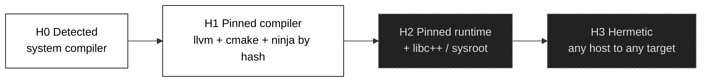
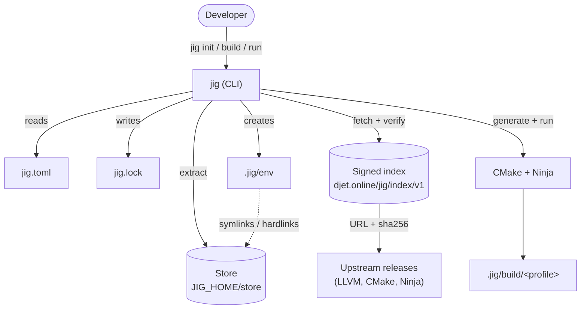
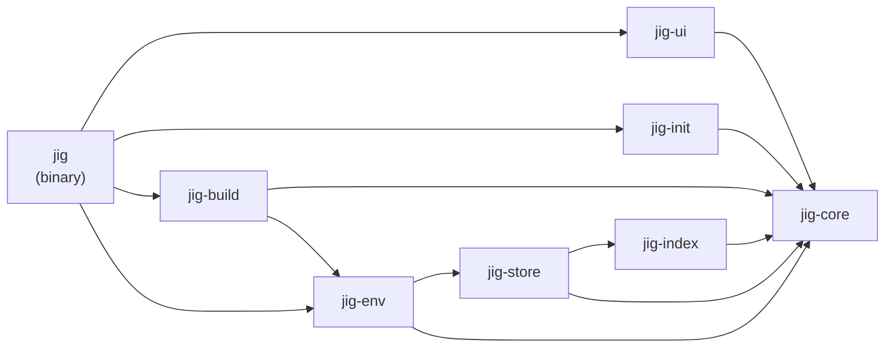

# 001 Foundations

**Phase goal:** fix the vocabulary, the scope, the decisions and the repository skeleton, so every later phase builds on the same ground.
**Depends on:** nothing. **Unlocks:** 002 to 012.
**Audience:** a coding agent that has not seen this project before. Read this file completely before touching code.

---

## 1. What jig is

jig is a command-line tool, written in C++23 and shipped as one static binary, that manages the **whole native workflow of a C or C++ project** the way `uv` manages Python projects and `cargo` manages Rust projects:

1. It **creates** a project, after asking (or being told) the language, the language standard, the compiler vendor and the compiler version.
2. It **provisions** that compiler, plus CMake and Ninja, from a signed index, into a shared content-addressed store.
3. It **isolates** the project in an environment (`.jig/env`) so that nothing about the machine's own compilers leaks in, unless the project asks for it.
4. It **builds, runs, tests and formats** using only what the lockfile names.
5. It **explains** every decision it takes, at every step, unless told to be quiet.

jig is the project and toolchain layer. It is not a new build system and not a new package manager. Underneath, it generates CMake and runs Ninja. For dependencies (from 009) it hands off to vcpkg or Conan.

## 2. Principles

These come from the DJET Systems values. When two designs are possible, the one that satisfies more of these wins.

| Principle | Meaning in this project |
|---|---|
| Order | One manifest (`jig.toml`), one lockfile (`jig.lock`), one environment directory (`.jig/`). No hidden state elsewhere. |
| Clarity | Verbose by default. Every resolved choice is printed with its reason. `--explain` prints the reasoning tree. |
| Resilience | Everything downloaded is verified (sha256 plus signature). Installs are atomic. A failed install never leaves a half-usable toolchain. `--offline` works from the store. |
| Discipline | Exact versions in the lock. `--locked` and `--frozen` fail instead of guessing. No network call without a reason that is printed. |
| Longevity | The index format is versioned and append-only. Old lockfiles keep working. Binary is static. No runtime dependency on Python, Node or a system C++ runtime. |
| Truth | `jig doctor` reports the real **hermeticity level** (section 6). The tool never claims isolation it does not have. |

## 3. Scope

### In scope for v0.1

- `init`, `toolchain` (list, available, install, use, pin, remove, which, update), `sync`, `env`, `shell`, `run`, `build`, `test`, `fmt`, `clean`, `lock`, `doctor`, `cache`, `self`, `completions`, `version`.
- Languages: C (C11, C17, C23) and C++ (C++14, C++17, C++20, C++23, C++26 where the compiler accepts it).
- Compiler providers: `llvm` (official prebuilt releases) and `system` (detect only: GCC, Clang, Apple Clang, MSVC).
- Tool providers: `cmake`, `ninja`.
- Hermeticity levels H0 and H1.
- Platforms: Linux x86_64, macOS arm64, Windows x86_64 (tier 1). Linux aarch64, macOS x86_64 (tier 2).
- Project kinds: executable, static library, shared library, header-only library.

### Out of scope for v0.1 (planned)

| Item | Planned phase |
|---|---|
| Dependencies (`add`, `remove`, vcpkg or Conan hand-off, git and path deps) | 009, release v0.2 |
| Zig `cc` provider, hermeticity H2 and H3, cross-compilation | v0.3 |
| GCC provider from third-party builds | v0.4, subject to a provenance review |
| Own build system, own package registry | not planned |
| IDE plugins | after v0.2; `compile_commands.json` and clangd cover most needs |

## 4. Glossary

| Term | Definition |
|---|---|
| Manifest | `jig.toml`, written by humans. Describes the project. |
| Lock | `jig.lock`, written by jig. Exact toolchain, tool and (later) dependency identities. |
| Index | Signed JSON catalogue of downloadable toolchains and tools. Published at `https://djet.online/jig/index/v1/`. |
| Provider | A module that knows one upstream source (`llvm`, `system`, later `zig`). |
| Store | Content-addressed directory of extracted toolchains. Shared by all projects on the machine. |
| Environment | `.jig/env` inside a project. Shims, activation scripts, a CMake toolchain file and `env.json`. |
| Profile | A named set of compile options (`debug`, `release`, user-defined). |
| Hermeticity level | How much of the build is pinned (H0 to H3, section 6). |
| Host triple | `x86_64-unknown-linux-gnu`, `aarch64-apple-darwin`, `x86_64-pc-windows-msvc`. |
| Std | The language standard, for example `c++23`, `c17`. |

## 5. Decision log

Decisions already taken. A coding agent must follow them. A change needs a new row, not a silent edit.

| ID | Decision | Reason | Reversible? |
|---|---|---|---|
| D-001 | Implement in **C++23**, single static binary (static C++ runtime). Changed from Rust on 2026-10-30 at the owner's direction. | A C/C++ toolchain should be built with C++, so jig can build itself (self-hosting from v0.2) and its authors live in the language it serves. Static binaries remain possible. | Costly |
| D-002 | Build layer is CMake plus Ninja, generated by jig. | Reuses the ecosystem. Keeps `compile_commands.json` and IDE support. | Yes, behind the `build.backend` key |
| D-003 | Toolchains come from a **signed index** owned by DJET, not from scraping upstream pages at runtime. | Pinned hashes, key rotation, offline mirroring, no fragile name parsing in the client. | Costly |
| D-004 | The store is content-addressed by the sha256 of the downloaded archive. | Dedup, integrity, simple prune. | Costly |
| D-005 | Project state lives in `jig.toml`, `jig.lock`, `.jig/`. User state lives in `JIG_HOME`. | Order. | Costly |
| D-006 | Project-authored material is licensed under **AGPL-3.0-only**. Vendored dependencies retain their own licenses and notices. | The project is distributed under the GNU GPL version 3 only; dependency terms remain independent. | Yes |
| D-007 | Default output is narrated and verbose. `--terse` and `-q` reduce it. | The product promise is clarity. | Yes |
| D-008 | Error identifiers `DJxxxx` are stable once released. | Searchability, docs, support. | No |
| D-009 | v0.1 does not bundle the Windows SDK or the macOS SDK. It detects them and fails with an actionable message. | Licensing and size. | Yes |
| D-010 | No telemetry in v0.1. | Truth, trust. Any future telemetry is opt-in. | Yes |
| D-011 | `jig run <target>` runs a project executable; `jig exec -- <cmd>` runs any command in the environment. | Avoids ambiguity between a target and a program. | Yes |
| D-012 | Argument parsing uses **CLI11** (header-only, BSD-3). Lyra and argparse were considered; `getopt.h` was rejected. | Nested subcommands, option groups, validators, env fallbacks, MSVC/GCC/Clang support. `getopt.h` is POSIX-only (Windows is tier 1) and has no subcommands or generated help. | Yes, parsing is isolated in `jig` main and `jig-ui` help |
| D-013 | Third-party libraries (**in the code today**: CLI11 and toml++ and tl::expected, vendored under `third_party/`; the rest are planned for the index, store and download phases): CLI11 (CLI), toml++ (manifest), nlohmann/json (index; simdjson if profiling asks), libarchive (tar.xz, tar.gz, zip, zstd), libcurl with a static TLS backend (HTTP), libsodium (sha256, ed25519), fmt or `std::format` (text), Catch2 (tests). Acquired through vcpkg manifest mode for the bootstrap build; vendored via `FetchContent` is the fallback. From v0.2 jig builds itself with its own dependency flow. | Mature, permissive, static-linkable. | Yes per library |
| D-014 | Language level for jig's own code: C++23. **Built and tested with GCC 13.3 and Clang 18.1** (Ubuntu 24.04, libstdc++ 13). `std::print` is not used, so GCC 13 is enough; GCC 14 is no longer required. Errors are returned as `jig::Result<T>`, which is `std::expected<T, jig::Error>` when the library provides it and the vendored `tl::expected` otherwise (Clang 18 with libstdc++ 13 needs the fallback). MSVC and Apple Clang are untested. Exceptions are used only to catch third-party failures at `main`. | Explicit errors, small binary, simple control flow. | Yes |

## 6. Hermeticity levels

This table is the most important idea in the project. The doctor command prints the level of the current project and says what would raise it.

| Level | Name | What is pinned | What still comes from the machine | Release |
|---|---|---|---|---|
| H0 | Detected | Nothing. jig found a compiler on the machine and records its path and version. | Everything | v0.1 |
| H1 | Pinned compiler | Compiler, CMake, Ninja, by hash. | libc, system headers, the C++ standard library on some platforms, platform SDK | v0.1 |
| H2 | Pinned runtime | H1 plus the compiler's own C++ standard library and a sysroot where the provider ships one. | Kernel interface, platform SDK on macOS and Windows | v0.3 |
| H3 | Hermetic | H2 on a provider that can build for the target from any host (Zig `cc` or a bundled sysroot). | Kernel only | v0.3 |

## 7. System context

## 8. Container view (libraries)

Rules for the dependency graph:

- `jig-core` depends on no other jig library.
- Only `jig-ui` prints. Every other library emits typed events (`Decision`, `Download`, ...) that `jig-ui` renders. This is what makes `--json` and `--terse` cheap.
- Only `jig-store` touches the network or the store directory.
- Only `jig-build` spawns the compiler or CMake.

## 9. Repository skeleton task list (agent checklist)

1. Create the top-level `CMakeLists.txt` (C++23, `CMAKE_CXX_STANDARD_REQUIRED ON`, extensions off) and the eight targets from REPO.md. Each library compiles with a stub source file and exports an alias target (`jig::core`, ...).
2. Add `CMakePresets.json` with presets `dev` (Debug, sanitizers on), `ci` (Release with warnings as errors) and `release` (Release, static runtime, LTO). Generator Ninja.
3. Add `vcpkg.json` with the libraries from D-013, and a baseline pin. Add `cmake/StaticRuntime.cmake`: static libstdc++/libgcc on Linux (`-static-libstdc++ -static-libgcc`), static CRT (`/MT`) on Windows, system libc++ on macOS (documented in 010).
4. Add `.clang-format`, `.clang-tidy` (bugprone, performance, modernize, readability subsets) and `.editorconfig`.
5. Add `.github/workflows/ci.yml`: build and test on Linux x86_64, macOS arm64, Windows x86_64 with the `ci` preset. Cache the vcpkg binary cache.
6. Add `CONTRIBUTING.md`, `SECURITY.md` (private disclosure address placeholder), `CHANGELOG.md` in Keep a Changelog format.
7. Add `src/jig-core/error.hpp` with `JigError`, the `ErrCode` enum and the `DJxxxx` registry skeleton (see `reference/errors.md`).
8. Add a smoke test (Catch2): `jig --version` prints `jig 0.1.0-dev` and exits 0.

**Acceptance for 001:** `cmake --preset ci && cmake --build --preset ci && ctest --preset ci` pass on the three tier-1 platforms; CI is green; `jig --version` and `jig --help` work; this docs tree is present.

## 10. Conventions for the coding agent

- Prefer small, typed events over `std::print` in library code. Only `jig-ui` writes to the terminal.
- Every user-visible string that explains a decision lives in `jig-ui`'s message catalogue so it can be reviewed in one place.
- Every function that can fail returns `std::expected<T, JigError>`. `JigError` carries a `code`, a one-line `summary`, a `help` string and an optional cause chain.
- No raw `new`/`delete`. Ownership through `std::unique_ptr` and values. No naked owning pointers in headers.
- No exceptions cross a library boundary. Wrap third-party throwing code (toml++, nlohmann/json, CLI11) at the edge and convert to `JigError`.
- Atomic file writes: write to a temp file in the same directory, `fsync`, rename (`MoveFileExW` with `MOVEFILE_REPLACE_EXISTING` on Windows).
- Paths are `std::filesystem::path`, converted to UTF-8 at the edges (`u8string`). A path that cannot be represented produces `DJ3004`.
- Platform code lives behind small interfaces in `jig-core/platform/` (`process`, `fs`, `terminal`, `dirs`). No `#ifdef _WIN32` outside that directory.
- Build with `-Wall -Wextra -Wpedantic -Wconversion` (or `/W4`) and treat warnings as errors in the `ci` preset. Run AddressSanitizer and UBSan in the `dev` preset.
- Tests are part of each phase; see 011.
