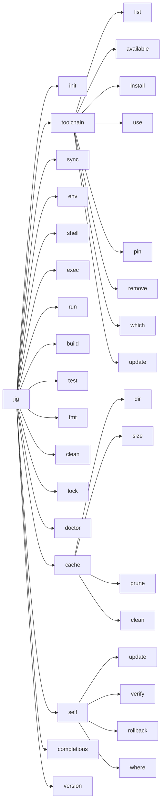
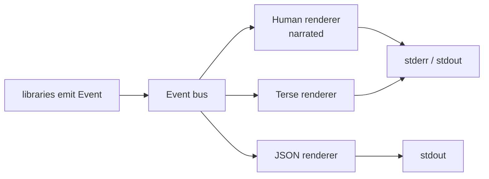

# 002 CLI and UX

**Phase goal:** implement the command surface, the output model, verbosity, exit codes and the interactive wizard shell. No toolchain logic yet: commands parse, validate, route to stubs, and print correctly.
**Depends on:** 001. **Unlocks:** 003 to 008.
**Libraries:** `jig` (executable), `jig-ui`, `jig-core` (config, errors).

---

## 1. Design goals

1. **Verbose by default.** A new user should be able to read the terminal and learn what jig did and why. `uv` is quiet; jig narrates.
2. **Options everywhere, prompts when missing.** Every question the wizard asks has a flag. When stdin is a TTY and a value is missing, jig asks. When it is not a TTY, jig fails with the exact flag to pass.
3. **Same output, three audiences.** Human text, `--terse` text, and `--json` lines are rendered from the same event stream.
4. **No surprises.** Anything that touches the network, writes outside the project, or installs a program says so first and (outside `-y`) asks.

## 2. Command tree



### 2.1 Summary table

| Command | Purpose | Needs project | Network |
|---|---|---|---|
| `jig init [PATH]` | Create a project (wizard or flags). | no | only to read the index |
| `jig toolchain list` | Show installed toolchains. | no | no |
| `jig toolchain available` | Show installable toolchains, filter by language, std, vendor. | no | index |
| `jig toolchain install <SPEC>` | Download, verify, extract into the store. | no | yes |
| `jig toolchain use <SPEC>` | Set the project's toolchain and re-sync. | yes | maybe |
| `jig toolchain pin <SPEC>` | Write exact version to `jig.toml` and lock. | yes | maybe |
| `jig toolchain which [TOOL]` | Print the real path of `cc`, `c++`, `cmake`, ... | yes | no |
| `jig toolchain remove <SPEC>` | Remove from the store (refuses if a lock needs it, unless `--force`). | no | no |
| `jig toolchain update` | Refresh the index, report newer patch releases. | no | index |
| `jig sync` | Make `.jig/env` match `jig.lock`. | yes | maybe |
| `jig lock` | Resolve and write `jig.lock`. | yes | index |
| `jig env` | Print the environment (`--format sh|fish|pwsh|cmd|json`). | yes | no |
| `jig shell` | Start a subshell with the environment active. | yes | no |
| `jig exec -- <CMD...>` | Run any command inside the environment. | yes | no |
| `jig build` | Configure and build. | yes | no |
| `jig run [TARGET] -- <ARGS...>` | Build, then run an executable target of the project. | yes | no |
| `jig test` | Build and run tests through CTest. | yes | no |
| `jig fmt` | Format with the pinned `clang-format`. | yes | no |
| `jig clean` | Remove build output (`--env` also removes `.jig/env`). | yes | no |
| `jig doctor` | Diagnose, report hermeticity level. | optional | no |
| `jig cache ...` | Inspect and prune the store and download cache. | no | no |
| `jig self update` | Update jig (from the index, verified). | no | yes |
| `jig completions <SHELL>` | Print shell completions. | no | no |
| `jig version` | Version, commit, index format, build date. | no | no |

**Note on `run` and `exec`.** `jig run <target> -- args` builds and runs an executable of the project. `jig exec -- <cmd>` runs an arbitrary command inside the environment (the equivalent of `uv run` for non-project commands). They are two commands so that a target named like a program can never be confused with a program. (Decision D-011.)

## 3. Global flags

| Flag | Env var | Effect |
|---|---|---|
| `-v`, `-vv`, `-vvv` | `JIG_VERBOSE=1..3` | More detail (section 5). |
| `-q`, `-qq` | `JIG_QUIET=1..2` | Less detail. `-qq` prints errors only. |
| `--terse` | `JIG_TERSE=1` | One line per step, no reasons. |
| `--explain` | | Print the reasoning tree for the decisions taken. |
| `--json` | `JIG_JSON=1` | Newline-delimited JSON events on stdout. Human text goes to stderr only if `-v`. |
| `--color <auto\|always\|never>` | `NO_COLOR`, `JIG_COLOR` | Colour control. |
| `--offline` | `JIG_OFFLINE=1` | Never touch the network. Fail with `DJ5001` if something is missing. |
| `--locked` | `JIG_LOCKED=1` | Fail if `jig.lock` is missing or out of date. |
| `--frozen` | `JIG_FROZEN=1` | `--locked` plus `--offline`. |
| `--manifest-path <PATH>` | `JIG_MANIFEST` | Use another `jig.toml`. |
| `--home <DIR>` | `JIG_HOME` | Override the user data directory. |
| `-y`, `--yes` | `JIG_YES=1` | Answer yes to confirmations, accept defaults in the wizard. |
| `--no-interactive` | `JIG_NO_INTERACTIVE=1` | Never prompt. Missing input is an error naming the flag. |
| `-h`, `--help` | | Help. `-h` is short, `--help` is long with examples. |
| `-V`, `--version` | | Version. |

## 4. Output model

All rendering goes through one pipeline.



### 4.1 Event types (non-exhaustive, the agent extends as needed)

```cpp
struct Step     { StepId id; std::string title; };                 // "Resolving toolchain"
struct Decision { StepId id; std::string what; std::string chosen;
                  std::vector<std::string> why; std::vector<Alt> alternatives; };
struct Download { std::string url; std::optional<std::uint64_t> bytes_total; std::uint64_t bytes_done; };
struct Verify   { std::string what; std::string sha256; bool ok; };
struct Install  { std::string name; std::filesystem::path path; };
struct Exec     { std::vector<std::string> argv; std::filesystem::path cwd;
                  std::vector<std::pair<std::string, std::optional<std::string>>> env_delta; };
struct Output   { Stream stream; std::string line; };              // compiler output passthrough
struct Warn     { std::optional<ErrCode> code; std::string msg; std::optional<std::string> help; };
struct Done     { StepId step; std::chrono::milliseconds took; std::string summary; };
struct Fail     { JigError err; };

using Event = std::variant<Step, Decision, Download, Verify, Install, Exec, Output, Warn, Done, Fail>;
```

`Decision` is the heart of the product. Every place that picks something (a compiler version, a std level, a generator, a profile) emits one.

### 4.2 Glyphs and colour

| Meaning | Glyph (Unicode) | Fallback (`TERM=dumb` or non-UTF-8) | Colour |
|---|---|---|---|
| Step | `▸` | `>` | bold |
| Decision | `◆` | `*` | default |
| Reason line | `│` | `\|` | dim |
| Ok | `✓` | `ok` | green |
| Warning | `!` | `!` | yellow |
| Error | `✗` | `x` | red |
| Download bar | `━` | `=` | default |

Colour is semantic only. The brand is monochrome; the terminal uses colour for ok, warn and error and nothing else.

## 5. Verbosity levels

| Level | Flag | What is printed |
|---|---|---|
| 0 quiet | `-qq` | Errors only. |
| 1 terse | `-q` / `--terse` | One line per step. |
| 2 **narrated (default)** | | Steps, decisions with reasons, results, timings of slow steps, next-step hint. |
| 3 detail | `-v` | Adds resolved paths, store locations, index digest, file counts, full compiler summary lines. |
| 4 commands | `-vv` | Adds every spawned command line, working directory, environment delta, per-step timings. |
| 5 trace | `-vvv` | Adds HTTP requests and responses (headers redacted), index parsing, cache hits and misses. |

### 5.1 Example, level 2 (default)

```
$ jig build

▸ Reading project
  │ jig.toml         hello 0.1.0   c++23   exe
  │ jig.lock         current (toolchain clang 20.1.8 · cmake 3.31.2 · ninja 1.12.1)
▸ Checking environment
  ◆ environment      .jig/env is in sync with jig.lock
▸ Configuring            profile: debug
  ◆ generator        Ninja            (set by environment, CMAKE_GENERATOR)
  ◆ std flag         -std=c++23       (clang 20.1.8 accepts c++23)
  ◆ compile commands .jig/build/debug/compile_commands.json → ./compile_commands.json
▸ Building               3 targets
  [3/3] Linking CXX executable hello
  ✓ built in 1.9 s     .jig/build/debug/hello

  next: jig run    ·   jig test    ·   jig build --profile release
```

(All version numbers in examples are illustrative.)

### 5.2 Example, level 4 (`-vv`) extra lines

```
  $ /home/ana/.jig/store/toolchains/llvm-20.1.8-x86_64-unknown-linux-gnu-9f3a1c2e/bin/clang++ --version
  $ cmake -S .jig/gen -B .jig/build/debug -G Ninja -DCMAKE_BUILD_TYPE=Debug -DCMAKE_TOOLCHAIN_FILE=.jig/env/toolchain.cmake
  env +PATH=.jig/env/bin:… +CC=…/clang +CXX=…/clang++ +JIG_ENV=…
```

## 6. Interactive wizard framework

Used by `init` (006) and `toolchain use` when no spec is given.

- Library: a small prompt layer (select, multi-select, text, confirm, and a **live preview pane**, a one-paragraph explanation under the cursor). Raw terminal control through `termios` on POSIX and the console API on Windows, behind `jig-core/platform/terminal`. FTXUI is an acceptable dependency if it keeps the binary small; decide during task 5 and record it as D-015.
- Every prompt has: `id`, flag name, default, validator, `explain()` text.
- A prompt is skipped when its flag was given, or when `-y` is set and a default exists.
- Prompts must never print raw escape sequences when stdout is not a TTY.
- Ctrl-C at any prompt exits 130 and writes nothing to disk.

### 6.1 Example, `jig init` (abridged; full flow in 006)

```
$ jig init hello

  jig · the native C/C++ toolchain                          DJET Systems

  ? Language                  › C++    C
  ? Standard                  › c++23  c++20  c++17  c++14  c++26 (experimental)
                                ╰ c++23 is accepted by clang 17 and newer
  ? Compiler                  › clang (llvm, pinned)   system (detect only)
  ? Compiler version          › 20.1.8 (latest 20.x)   19.1.7   18.1.8
                                ╰ 4 versions accept c++23 on this machine's platform
  ? Project kind              › executable   static library   shared library   header-only
  ? Initialise git            › yes   no
```

## 7. Exit codes

| Code | Name | Meaning |
|---|---|---|
| 0 | ok | Success. |
| 1 | failure | A command failed for a reason not listed below. |
| 2 | usage | Bad flags or arguments. |
| 3 | project | Manifest or lock problem (`DJ1xxx`). |
| 4 | toolchain | Resolution or provider problem (`DJ2xxx`). |
| 5 | network | Network or offline problem (`DJ5xxx`). |
| 6 | integrity | Hash, signature or archive-safety failure (`DJ5101` to `DJ5103`, `DJ5105`, `DJ7003`). Never retried silently. The authoritative code-to-exit mapping is `reference/errors.md`. |
| 7 | build | The compiler or CMake returned an error (`DJ4xxx`). |
| 8 | test | Tests failed. |
| 101 | bug | Internal error. Prints a bug-report URL. |
| 130 | interrupted | Ctrl-C. |

## 8. Error rendering

```
✗ DJ2101  No toolchain satisfies "clang@25" for this platform

  The index has these clang versions for x86_64-unknown-linux-gnu:
    18.1.8   19.1.7   20.1.8
  help: use one of them, for example `jig toolchain use clang@20`
        or list everything with `jig toolchain available --vendor llvm`
  docs: https://djet.online/jig/docs/errors#DJ2101
```

Rules: first line is `✗ <code>  <summary>`; body states facts, not blame; `help:` gives a runnable command; `docs:` links to the anchor in `reference/errors.md`.

## 9. Help text rules

- `jig --help` lists the command tree with one line each and three example invocations.
- Every subcommand `--help` has: synopsis, description, options grouped (Selection, Output, Network, Safety), **examples** (at least two), and a "See also" line.
- Help text is a source file under `src/cli/help/*.md` so docs can be generated from it (`reference/cli.md` is the reference sheet for the finished surface).

## 10. Use cases (acceptance scenarios)

| # | Scenario | Expected |
|---|---|---|
| U1 | `jig build` outside any project | Exit 3, `DJ1001 No jig.toml found`, help suggests `jig init`. |
| U2 | `jig init` in CI (no TTY) with no flags | Exit 2, message lists the flags required: `--lang`, `--std`, `--toolchain`. |
| U3 | `jig build --frozen` with stale lock | Exit 3, `DJ1103`, nothing downloaded. |
| U4 | `jig --json build` | Every stdout line parses as JSON; last line is `{"event":"done",...}` or `{"event":"fail",...}`. |
| U5 | `NO_COLOR=1 jig build` | No ANSI sequences. |
| U6 | Ctrl-C during a download | Exit 130, partial file removed, store unchanged. |
| U7 | Terminal without UTF-8 | ASCII glyph fallback. |

## 11. Tasks for the agent

1. Define `Event`, the renderers and the glyph table in `jig-ui`. Add golden-file tests (Catch2, expected output files under `tests/golden/`) for the three renderers over a scripted event list.
2. Define the CLI11 command tree with every flag above (D-012). Generate `reference/cli.md` from the tree in a test and fail CI when it drifts.
3. Implement config layering in `jig-core::config` (see 003 section 6) and expose a resolved `Settings` struct.
4. Implement exit-code mapping from `JigError::code` ranges.
5. Implement the wizard framework with a mock backend, so 006 can plug in questions.
6. Implement `jig version`, `jig completions`, and `jig doctor --help` stubs.

**Acceptance for 002:** all use cases U1 to U7 pass as integration tests using stub commands; `jig --help` output matches the snapshot; the CLI reference test passes.
