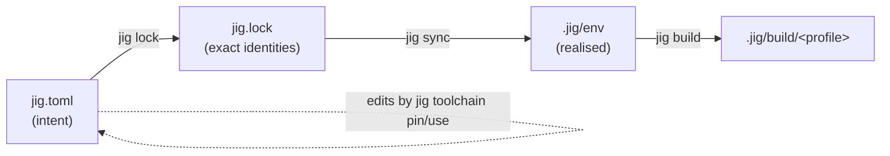
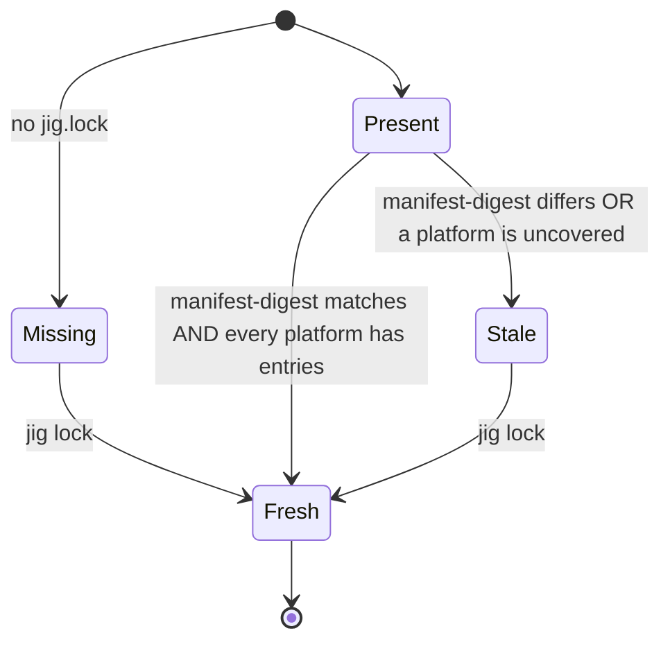

# 003 Manifest, lockfile and configuration

**Phase goal:** define, parse, validate and write `jig.toml`, `jig.lock` and the layered configuration. Implement version-spec parsing and the lock freshness check. No downloads yet.
**Depends on:** 001, 002. **Unlocks:** 004 to 008.
**Libraries:** `jig-core` (all of it). **Third party:** toml++ (parse and edit with comment preservation where possible), nlohmann/json (JSON Schema export only).

---

## 1. Files at a glance

| File | Author | Location | Commit to VCS? |
|---|---|---|---|
| `jig.toml` | human | project root | yes |
| `jig.lock` | jig | project root | yes |
| `.jig/` | jig | project root | no (jig writes `.jig/.gitignore` containing `*`) |
| `config.toml` | human | user config dir | n/a |
| `index/` cache, `store/`, `cache/` | jig | `JIG_HOME` | n/a |



Intent flows down, never up. The only way jig writes `jig.toml` is through commands that say so (`toolchain use`, `toolchain pin`, `init`, and from 009 `add` and `remove`).

## 2. `jig.toml` schema

### 2.1 Sections

| Section | Required | Purpose |
|---|---|---|
| `[project]` | yes | Identity, kind, language, std. |
| `[toolchain]` | yes (written by `init`) | Which compiler and tools. |
| `[build]` | no | Sources, includes, defines, backend. |
| `[profile.<name>]` | no | Compile options. `debug` and `release` exist by default. |
| `[[target]]` | no | Extra targets. Without any, one target named after the project is implied. |
| `[test]` | no | Test sources and runner. |
| `[fmt]` | no | Formatter settings. |
| `[env]` | no | Environment variables and host-env inheritance. |
| `[dependencies]` | v0.2 | Reserved. A v0.1 parser rejects it with `DJ1006` and a pointer to the roadmap. |

### 2.2 `[project]`

| Key | Type | Default | Rules |
|---|---|---|---|
| `name` | string | directory name | `[a-z][a-z0-9_-]{0,63}`. Used as the default target and package name. |
| `version` | string | `0.1.0` | SemVer. |
| `description` | string | empty | One line. |
| `license` | string | empty | SPDX expression. |
| `authors` | array of strings | empty | |
| `kind` | enum | `exe` | `exe`, `static-lib`, `shared-lib`, `header-only`. |
| `language` | enum | required | `c` or `c++`. |
| `std` | string | required | C: `c11`, `c17`, `c23`. C++: `c++14`, `c++17`, `c++20`, `c++23`, `c++26`. |
| `extensions` | bool | `false` | `true` maps to the `gnu` dialect (`-std=gnu++23`). |
| `platforms` | array of host triples | current host plus the tier-1 hosts | Hosts the lockfile must cover. |

### 2.3 `[toolchain]`

| Key | Type | Default | Rules |
|---|---|---|---|
| `vendor` | enum | `llvm` | `llvm` or `system`. v0.3 adds `zig`. |
| `version` | version spec | `latest` | Section 4. Ignored for `system` unless a version check is wanted. |
| `hermeticity` | enum | `h1` for `llvm`, `h0` for `system` | Minimum acceptable level. A build below it fails with `DJ2301`. |
| `tools.cmake` | version spec | `>=3.20,<5` | |
| `tools.ninja` | version spec | `1` | |
| `tools.clang-format` | version spec or `"bundled"` | `"bundled"` | Uses the one inside the LLVM toolchain. |
| `system.cc`, `system.cxx` | path or name | detected | Only with `vendor = "system"`. |

### 2.4 `[build]`

| Key | Type | Default | Notes |
|---|---|---|---|
| `backend` | enum | `generated` | `generated`: jig writes the CMake project. `cmake`: use the project's own `CMakeLists.txt`, with the jig toolchain file injected. `none`: no build step (the environment only). |
| `sources` | globs | `["src/**/*.{c,cc,cpp,cxx}"]` | Relative to the project root. |
| `include` | paths | `["include", "src"]` | Private include directories. |
| `public-include` | paths | `["include"]` | Exported by libraries. |
| `defines` | array | `[]` | `NAME` or `NAME=VALUE`. |
| `warnings` | enum | `default` | `off`, `default`, `strict` (`-Wall -Wextra -Wpedantic` or `/W4`). |
| `link` | array | `[]` | System libraries by name (`m`, `pthread`). |
| `cmake-args` | array | `[]` | Extra `-D` arguments for the `cmake` backend. |

### 2.5 `[profile.<name>]`

| Key | Type | `debug` | `release` |
|---|---|---|---|
| `opt` | `"0" "1" "2" "3" "s" "z"` | `"0"` | `"3"` |
| `debug` | bool | `true` | `false` |
| `lto` | `false` `"thin"` `"full"` | `false` | `"thin"` |
| `sanitizers` | array of `address`, `undefined`, `thread`, `memory` | `[]` | `[]` |
| `assertions` | bool | `true` | `false` |
| `defines` | array | `[]` | `[]` |
| `inherits` | profile name | | |

### 2.6 `[[target]]`

```toml
[[target]]
name = "hello-cli"
kind = "exe"
sources = ["src/cli/**/*.cpp"]
link-targets = ["hello-core"]   # other targets in this project
```

### 2.7 `[test]`, `[fmt]`, `[env]`

```toml
[test]
sources = ["tests/**/*.cpp"]
runner  = "ctest"          # v0.1: ctest only
args    = ["--output-on-failure"]

[fmt]
style = "file"             # "file" uses .clang-format; or "llvm" | "google" | "mozilla" | "webkit"

[env]
inherit = "minimal"        # none | minimal | all   (section 2.8)
set = { HELLO_MODE = "dev" }
```

### 2.8 Host-environment inheritance

| Value | What the environment keeps from the caller |
|---|---|
| `none` | Nothing except `HOME`/`USERPROFILE`, `TMPDIR`/`TEMP`, `TERM`, locale. |
| `minimal` (default) | The above plus `PATH` entries that are **after** `.jig/env/bin`, and proxy variables. |
| `all` | Everything. Reported by `doctor` as lowering confidence. |

## 3. Complete example

```toml
[project]
name        = "hello"
version     = "0.1.0"
description = "A first jig project"
license     = "MIT"
kind        = "exe"
language    = "c++"
std         = "c++23"
platforms   = ["x86_64-unknown-linux-gnu", "aarch64-apple-darwin", "x86_64-pc-windows-msvc"]

[toolchain]
vendor      = "llvm"
version     = "20"
hermeticity = "h1"

[toolchain.tools]
cmake = "3.31"
ninja = "1.12"

[build]
warnings = "strict"
defines  = ["HELLO_VERSION=\"0.1.0\""]

[profile.debug]
sanitizers = ["address", "undefined"]

[profile.release]
lto = "thin"

[test]
sources = ["tests/**/*.cpp"]

[env]
inherit = "minimal"
```

## 4. Version specifications

Grammar:

```
spec      = "latest" | range
range     = comparator { "," comparator }
comparator= [ op ] version
op        = "=" | "^" | "~" | ">=" | ">" | "<=" | "<"
version   = major [ "." minor [ "." patch ] ]  [ "-" prerelease ]
```

| Spec | Meaning |
|---|---|
| `20` | Any `20.x.y`. Resolves to the highest. |
| `20.1` | Any `20.1.y`. |
| `20.1.8` | Exactly. |
| `^20` | `>=20.0.0, <21.0.0` (same as `20`). |
| `~20.1` | `>=20.1.0, <20.2.0`. |
| `>=18,<21` | Range. |
| `latest` | Highest stable. Never a prerelease. |
| `20.1.8-rc1` | Prereleases only when named. |

**Resolution algorithm** (implemented once in `jig-core::resolve`, used by `lock`, `init`, `toolchain use`):

1. Candidates = index entries with `vendor`, matching `host`.
2. Drop candidates that do not satisfy the spec.
3. Drop candidates whose `std_support` does not contain the project `std` (the index lists accepted `-std=` values per compiler; see 004).
4. Drop candidates whose hermeticity is below `toolchain.hermeticity`.
5. Prefer stable over prerelease. Pick the highest version. Break ties by the most recent `published_at`.
6. Emit a `Decision` event with the chosen entry, the number of candidates dropped at each step, and the next best alternative.

If the result is empty, the error is `DJ2101` and lists the nearest versions that failed only the std filter, because that is the most common surprise.

## 5. `jig.lock`

```toml
# This file is written by jig. Do not edit.
version = 1

[meta]
generated-by = "jig 0.1.0"
index-digest = "sha256:5f1b...e0"           # digest of the signed index used
manifest-digest = "sha256:a77c...19"        # digest of the normalised [project] and [toolchain] and [toolchain.tools] tables

[[toolchain]]
vendor    = "llvm"
version   = "20.1.8"
host      = "x86_64-unknown-linux-gnu"
id        = "llvm-20.1.8-x86_64-unknown-linux-gnu"
url       = "https://github.com/llvm/llvm-project/releases/download/..."
sha256    = "9f3a1c2e..."
size      = 912345678
provides  = ["clang", "clang++", "clang-format", "clang-tidy", "clangd", "lld", "llvm-ar"]
hermeticity = "h1"

[[toolchain]]
vendor    = "llvm"
version   = "20.1.8"
host      = "aarch64-apple-darwin"
# ... one table per host in project.platforms ...

[[tool]]
name      = "cmake"
version   = "3.31.2"
host      = "x86_64-unknown-linux-gnu"
sha256    = "..."
url       = "..."

[[tool]]
name      = "ninja"
version   = "1.12.1"
host      = "x86_64-unknown-linux-gnu"
sha256    = "..."
url       = "..."
```

(Hashes and URLs above are placeholders.)

### 5.1 Freshness



| Situation | Normal command | `--locked` | `--frozen` |
|---|---|---|---|
| Fresh | proceeds | proceeds | proceeds |
| Stale | re-locks (network if needed), prints why | fails `DJ1103` | fails `DJ1103` |
| Missing | creates it | fails `DJ1102` | fails `DJ1102` |

### 5.2 Rules

- The lock never contains absolute local paths, usernames or timestamps. It is byte-identical for two machines that resolve the same thing.
- Tables are sorted by `host`, then `vendor` or `name`, so diffs are small.
- A lock written by a newer jig (`version` greater than supported) fails with `DJ1104` and asks the user to upgrade.

## 6. Configuration layering

Precedence, highest first:

1. Command-line flags.
2. Environment variables (`JIG_*`).
3. Project `jig.toml` (only keys defined in section 2).
4. User `config.toml`.
5. Built-in defaults.

### 6.1 User `config.toml`

Location: Linux `$XDG_CONFIG_HOME/jig/config.toml` (fallback `~/.config/jig/`), macOS `~/Library/Application Support/jig/`, Windows `%APPDATA%\jig\`.

```toml
[ui]
verbosity = 2            # 0..5 as in 002
color     = "auto"
glyphs    = "auto"       # auto | unicode | ascii

[network]
offline    = false
proxy      = ""          # empty = from the environment
index-url  = "https://djet.online/jig/index/v1/"
mirror     = ""          # a directory or URL mirroring the index and archives

[store]
home = ""                # empty = platform default for JIG_HOME

[defaults]
language  = "c++"
std       = "c++23"
vendor    = "llvm"
vcs       = "git"
```

### 6.2 Directories

| Purpose | Linux | macOS | Windows |
|---|---|---|---|
| `JIG_HOME` (store, cache, index) | `$XDG_DATA_HOME/jig` or `~/.local/share/jig` | `~/Library/Application Support/jig` | `%LOCALAPPDATA%\jig` |
| Config | `~/.config/jig` | `~/Library/Application Support/jig` | `%APPDATA%\jig` |

`JIG_HOME` always wins when set.

## 7. Validation and errors (this phase)

| Code | Condition |
|---|---|
| DJ1001 | No `jig.toml` found in the directory or any parent. |
| DJ1002 | `jig.toml` is not valid TOML. Message includes line and column. |
| DJ1003 | Unknown key. Message names the nearest valid key. |
| DJ1004 | Wrong type for a key. |
| DJ1005 | Invalid `name`. |
| DJ1006 | Section reserved for a later release (`[dependencies]`). |
| DJ1007 | `std` not valid for `language`. |
| DJ1008 | Invalid version spec. |
| DJ1102 | `jig.lock` missing under `--locked` or `--frozen`. |
| DJ1103 | `jig.lock` stale under `--locked` or `--frozen`. |
| DJ1104 | `jig.lock` written by a newer format. |
| DJ1105 | `jig.lock` is malformed. |

Unknown keys are errors, not warnings. This is deliberate (Discipline). A `--allow-unknown-keys` flag exists for tools that extend the manifest.

## 8. Agent tasks

1. Implement `Manifest`, `Lock`, `Settings` types and TOML (de)serialisation through toml++ with edge-wrapped exceptions.
2. Implement the version-spec parser and the comparator, with a property-style test over random specs and versions (Catch2 generators).
3. Implement `resolve()` over an in-memory index fixture (the real index arrives in 004).
4. Implement `normalise_digest()` for `manifest-digest`: key order fixed, whitespace ignored, comments ignored.
5. Implement config layering with a test per precedence step.
6. Implement `jig lock` against the fixture index and `jig toolchain use/pin` editing `jig.toml` while preserving comments and key order (toml++ node editing; fall back to a minimal line-based editor for the keys jig owns).
7. Export a JSON Schema of the manifest to `docs/reference/jig.schema.json` from a test, and fail CI on drift.

**Acceptance for 003:** all codes in section 7 are reproducible from fixtures; `jig lock` is idempotent (running it twice changes no bytes); the manifest in section 3 round-trips; `reference/manifest.md` and the schema agree.
