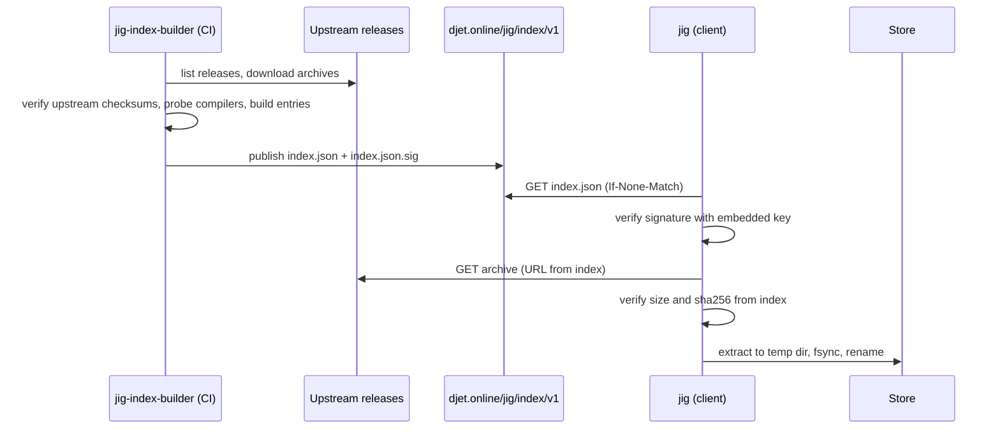
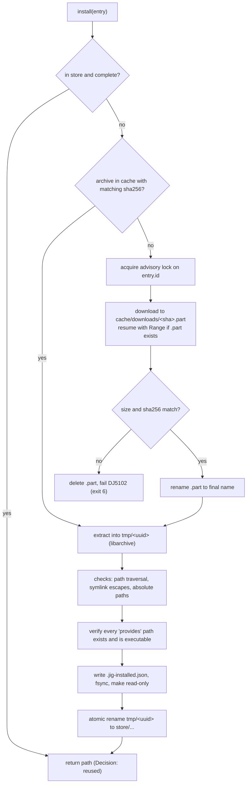

# 004 Toolchain index, providers and store

**Phase goal:** fetch and verify the signed index, resolve entries to downloads, download and extract them into the content-addressed store, atomically, with progress and with offline support.
**Depends on:** 001 to 003. **Unlocks:** 005 to 008.
**Libraries:** `jig-index`, `jig-store`. **Tool:** `jig-index-builder`.
**Third party:** libcurl (static TLS), libarchive, libsodium, nlohmann/json.

---

## 1. Why a DJET-owned index

Upstream projects publish binaries in many layouts and names, and rename them between releases. Scraping at runtime makes the client fragile and unverifiable. jig instead trusts one **signed index** that DJET generates in CI from upstream releases:

- the index pins each archive by URL, size and sha256, so the client downloads from upstream but trusts only the hash in the signed index;
- the index carries the **probed facts** the client needs offline: which `-std=` values the compiler accepts, which binaries it provides, which hermeticity level it can reach;
- the index can be mirrored by copying a directory.



## 2. Index format v1

Files at `https://djet.online/jig/index/v1/`:

| File | Purpose |
|---|---|
| `index.json` | The catalogue. |
| `index.json.sig` | Detached ed25519 signature of the exact bytes of `index.json`. |
| `keys.json` | Public keys currently trusted, with validity windows. Signed by a root key embedded in jig. |
| `archive/` | Optional mirror of archives (empty at v0.1; upstream is used). |

### 2.1 `index.json` shape

```json
{
  "format": 1,
  "generated_at": "2026-11-01T00:00:00Z",
  "generator": "jig-index-builder 0.1.0",
  "entries": [
    {
      "id": "llvm-20.1.8-x86_64-unknown-linux-gnu",
      "kind": "toolchain",
      "vendor": "llvm",
      "version": "20.1.8",
      "prerelease": false,
      "host": "x86_64-unknown-linux-gnu",
      "published_at": "2025-07-01T00:00:00Z",
      "archive": {
        "url": "https://github.com/llvm/llvm-project/releases/download/.../clang+llvm-....tar.xz",
        "format": "tar.xz",
        "size": 912345678,
        "sha256": "9f3a1c2e...",
        "strip_components": 1
      },
      "provides": {
        "clang": "bin/clang",
        "clang++": "bin/clang++",
        "clang-format": "bin/clang-format",
        "clang-tidy": "bin/clang-tidy",
        "clangd": "bin/clangd",
        "lld": "bin/ld.lld",
        "llvm-ar": "bin/llvm-ar"
      },
      "languages": {
        "c":   ["c11", "c17", "c23"],
        "c++": ["c++14", "c++17", "c++20", "c++23", "c++26"]
      },
      "hermeticity_max": "h1",
      "requires_host": ["libc>=2.28"],
      "upstream": { "project": "llvm-project", "tag": "llvmorg-20.1.8" }
    }
  ]
}
```

(All values are illustrative placeholders. The real file is produced by the builder.)

Entry kinds: `toolchain` (compilers), `tool` (cmake, ninja). Tool entries have the same shape with `provides` listing the binaries and no `languages`.

`languages` is **measured, not copied**: the builder runs each compiler with `-std=<value> -fsyntax-only` on a tiny file and records which values it accepts. This is what lets `init` offer only standards the chosen compiler really accepts.

### 2.2 Signature scheme

- ed25519 over the raw bytes of `index.json`. The client verifies with libsodium (`crypto_sign_verify_detached`).
- `keys.json` lists public keys with `valid_from`, `valid_until`, and is itself signed by a **root key** whose public half is compiled into jig. Rotating the day-to-day key therefore needs no client release. Rotating the root key needs a client release and is announced in `CHANGELOG.md`.
- Failure to verify is `DJ5101` and exit code 6. jig never falls back to an unsigned index. There is no flag to skip verification. (`--index-file` accepts a local file **only** if its signature also verifies.)

### 2.3 Client caching

- Cache at `JIG_HOME/index/v1/`. Uses `ETag`/`If-None-Match`. A cached index younger than 24 hours is reused without a request unless `jig toolchain update` is run.
- `--offline` uses the cached index. If none exists: `DJ5001`.
- Staleness warning: an index older than 30 days prints a `Warn` once per day.

## 3. Providers

A provider is an interface plus a small amount of platform logic.

```cpp
struct ToolchainProvider {
  virtual ~ToolchainProvider() = default;
  virtual std::string_view vendor() const = 0;                       // "llvm", "system"
  virtual std::expected<std::vector<Candidate>, JigError>
          list(const Host&, const IndexView&) const = 0;
  virtual std::expected<Installed, JigError>
          materialise(const Candidate&, Store&, EventSink&) const = 0;  // llvm: download+extract; system: detect
  virtual std::expected<Probe, JigError>
          probe(const Installed&) const = 0;                          // run --version, capture target triple
};
```

| Provider | v0.1 behaviour |
|---|---|
| `llvm` | Candidates from the index. `materialise` downloads, verifies and extracts into the store. |
| `system` | No download. Searches for compilers (section 3.1). Never writes to the store. Records path and version in the environment, not in the lock (the lock records `vendor = "system"` and the **detected** version for information). |
| `cmake`, `ninja` | Tool entries, same flow as `llvm`. |

### 3.1 System compiler detection

| Platform | Search order |
|---|---|
| Linux | `$CC`/`$CXX` if set and `--respect-cc` given, then `cc`, `c++`, `gcc`, `g++`, `clang`, `clang++` on `PATH`, then `/usr/bin`, `/usr/local/bin`. |
| macOS | `xcrun --find clang` and `clang++` (Apple Clang), then `PATH`. SDK path from `xcrun --show-sdk-path`. |
| Windows | `vswhere.exe` (found under `%ProgramFiles(x86)%\Microsoft Visual Studio\Installer`) for `cl.exe` and the VS developer environment; then `clang-cl`, `clang++`, `g++` on `PATH`. |

Each candidate is run with `--version` (or `/?` for `cl`) and the triple is read from `-dumpmachine` where supported. Failures are reported per candidate with `-v`.

## 4. The store

```
JIG_HOME/
  index/v1/                 index.json, index.json.sig, keys.json, etag
  cache/downloads/          partial and complete archives, by sha256
  store/
    toolchains/<id>-<sha8>/ extracted tree, read-only after install
    tools/<name>-<ver>-<host>-<sha8>/
  tmp/                      staging for atomic installs
  locks/                    advisory lock files
```

- `<sha8>` is the first eight hex digits of the archive sha256. Two archives never share a directory.
- Extracted trees are made read-only after install (permissions on POSIX, `FILE_ATTRIBUTE_READONLY` on Windows).
- A `.jig-installed.json` file inside each tree records the entry, the install time and the verification result. Its presence marks a **complete** install; a directory without it is garbage and is removed by the next run.

### 4.1 Install algorithm



### 4.2 Safety rules for extraction (non-negotiable)

- Reject any member whose normalised path escapes the destination (`..`, absolute path, drive letter).
- Reject hard links or symlinks that point outside the destination. Symlinks inside the tree are allowed and re-created.
- Strip `strip_components` leading directories.
- Cap total extracted bytes at `size * 12` and file count at 2,000,000, to stop archive bombs. Exceeding either is `DJ5105`.
- Never run any file from the archive during install. Probing (`--version`) happens after the atomic rename, in a separate step.

### 4.3 Concurrency

Two jig processes installing the same entry take an advisory lock (`flock` on POSIX, `LockFileEx` on Windows) on `locks/<id>`. The second waits (printing `Waiting for another jig to finish installing <id>`) and then finds the install complete.

### 4.4 Pruning

`jig cache prune` removes archives from `cache/downloads` and store entries **not referenced by any lock** that jig has seen. The set of seen projects is kept in `JIG_HOME/projects.json` (project path, lock digest, last used), updated by `sync`. `--dry-run` is the default; `--apply` deletes. Referenced entries are never removed. `toolchain remove --force` is the only override.

## 5. Progress and events

Download progress emits `Download` events at most ten times per second. Human renderer draws a bar; JSON renderer emits `bytes_done` events at most twice per second. Install steps emit `Step`, `Verify`, `Install`. Decisions emitted here:

| Decision | Reason lines |
|---|---|
| `reused` | "found in store, sha256 verified at install" |
| `resumed` | "partial download found, resuming at byte N" |
| `mirror` | "index mirror configured, using it" |

## 6. Example transcript

```
$ jig toolchain install clang@20

▸ Reading index
  ◆ index            cached, 3 h old, signature ok (key jig-2026-a)
▸ Resolving clang@20 for x86_64-unknown-linux-gnu
  ◆ chosen           llvm 20.1.8
  │ 3 candidates match the version, 3 accept c++23, none dropped
  │ next best        llvm 20.1.7
▸ Downloading llvm-20.1.8-x86_64-unknown-linux-gnu           868 MiB
  ━━━━━━━━━━━━━━━━━━━━━━━━━━━━━━━━━━━━━━━━━━━━━━━━━  100%   41 MiB/s   21 s
  ✓ size and sha256 match the signed index
▸ Installing
  │ extracting 14 211 files · checks: paths ok, links ok, no setuid
  │ provides: clang, clang++, clang-format, clang-tidy, clangd, lld, llvm-ar  all present
  ✓ installed at ~/.local/share/jig/store/toolchains/llvm-20.1.8-x86_64-unknown-linux-gnu-9f3a1c2e
```

(Sizes, counts and versions are illustrative.)

## 7. `jig-index-builder` (tool)

Runs in CI (`.github/workflows/index.yml`) on a schedule and on demand.

1. Read `tools/jig-index-builder/sources.toml`: a list of upstream sources with a matcher per (vendor, host), for example the GitHub releases of `llvm/llvm-project` and the release assets of CMake and Ninja.
2. For each new release: download, verify the upstream checksum where one is published, compute sha256 and size.
3. Extract in a sandbox, locate `provides` binaries, run `--version`, run the `-std=` probes, record results. Assign `hermeticity_max`.
4. Merge into the previous index. **Entries are append-only**: an entry already published is never changed or removed (revocation uses a separate `revoked` array with a reason; clients refuse revoked entries with `DJ2401`).
5. Sign with the day-to-day key held in the CI secret store. Publish `index.json`, `index.json.sig`, `keys.json`.
6. Open a PR instead of publishing automatically when the diff contains more than a configured number of new entries or any removed key.

`sources.toml` and the matchers are data. Adding a vendor in 009-or-later means adding a matcher and a provider, not changing the client.

## 8. Errors (this phase)

| Code | Condition |
|---|---|
| DJ2101 | No candidate satisfies the spec. |
| DJ2102 | Spec matched, but no candidate accepts the project `std`. |
| DJ2201 | System compiler not found. |
| DJ2202 | System compiler found but unusable (probe failed). |
| DJ2401 | Entry revoked. |
| DJ5001 | Offline and not in cache or store. |
| DJ5002 | HTTP error. Message has status and URL. |
| DJ5003 | Timeout. |
| DJ5101 | Index signature invalid. |
| DJ5102 | Archive hash or size mismatch. |
| DJ5103 | Unknown or expired signing key. |
| DJ5104 | Index format newer than the client supports. |
| DJ5105 | Archive failed safety checks. |

## 9. Agent tasks

1. Implement the index types, the JSON reader, signature verification (libsodium) and the key-chain logic. Test with fixtures: valid, tampered, wrong key, expired key, newer format.
2. Implement an HTTP client wrapper over libcurl: timeouts, retries with backoff for 5xx and connection resets (never for hash failures), `Range` resume, proxy from environment, `--offline` guard at the lowest layer.
3. Implement the store, the install algorithm, advisory locks, the extraction safety checks. Test with malicious archive fixtures (`../`, absolute path, symlink escape, bomb).
4. Implement the `llvm` provider and the tool providers on a **local fixture server** (a tiny HTTP server in the test harness serving a small fake toolchain archive that contains shell scripts named `clang` and `clang++`).
5. Implement the `system` provider with fake `PATH` fixtures per platform.
6. Implement `toolchain list`, `available`, `install`, `which`, `remove`, `update` and `cache` (dir, size, prune).
7. Implement `jig-index-builder` against a local directory of fake releases first; point it at real upstreams only in the release pipeline (010).

**Acceptance for 004:** installing from the fixture server works, is resumable, is atomic under `kill -9` at any point (a test kills the process at random offsets and asserts the store never contains a complete-marked broken install), and every error code in section 8 is reproducible. `--offline` installs from cache without touching the network.
