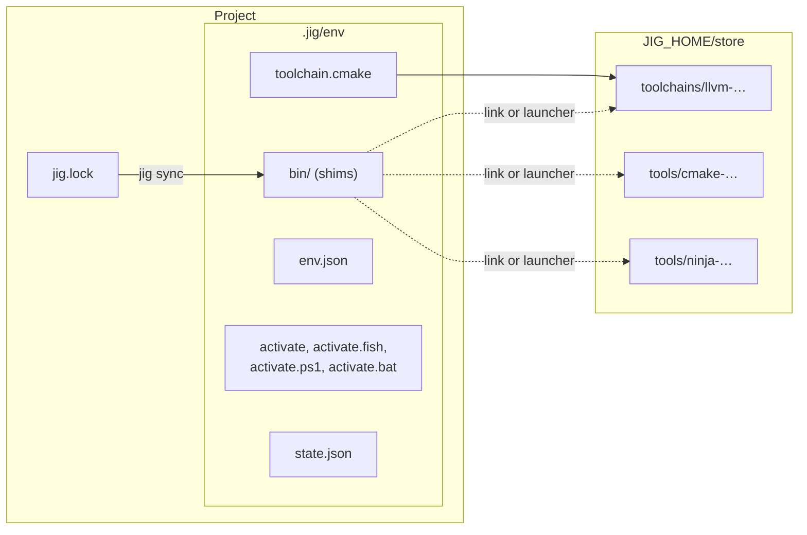
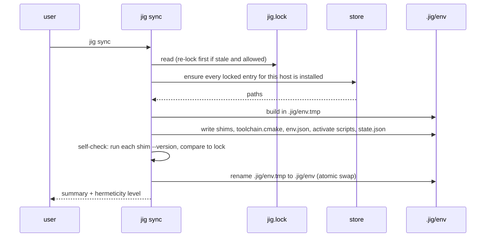

# 005 Project environment

**Phase goal:** build `.jig/env`, the per-project environment that makes the pinned toolchain the only toolchain the project can see. Implement `sync`, `env`, `shell`, `exec`, shims and activation for every shell.
**Depends on:** 001 to 004. **Unlocks:** 006 to 008.
**Libraries:** `jig-env`, small additions in `jig-core/platform`. **Extra binary:** `jig-shim` (Windows launcher, optional on POSIX).

---

## 1. The idea in one picture

`uv` gives a Python project a `.venv`. jig gives a C or C++ project a `.jig/env`. The environment does not copy toolchains; it **points** into the shared store, so ten projects on one machine that pin the same compiler share one copy on disk.



## 2. Layout

```
.jig/
  .gitignore              contains "*"
  env/
    bin/
      cc  c++  clang  clang++  clang-format  clang-tidy  clangd  lld  llvm-ar  cmake  ctest  ninja
    toolchain.cmake        compilers, archiver, generator, compile_commands switch
    env.json               the resolved variables (section 4)
    state.json             { "lock_digest": "...", "host": "...", "synced_at": "...", "jig": "0.1.0" }
    shims.json             shim -> real path map (used by jig-shim)
    activate               sh, bash, zsh
    activate.fish
    activate.ps1
    activate.bat
  gen/                     generated CMake project (007)
  build/<profile>/         build trees (007)
```

`.jig/` can be deleted at any time. `jig sync` recreates it exactly from `jig.lock` and the store.

## 3. Shims

| Shim kind | Used when | How |
|---|---|---|
| `link` | Linux and macOS (default) | Symbolic link from `bin/<name>` to the store binary. |
| `launcher` | Windows (default), or POSIX when a link breaks resource lookup | A copy of `jig-shim.exe`. At run time it reads `shims.json`, finds its own name, and starts the real binary with the original arguments, preserving the exit code and the standard streams. |

Rules:

- `cc` and `c++` always exist and point at the pinned `clang` and `clang++` (for `vendor = "llvm"`), so scripts that call `cc` stay inside the environment.
- A shim never exists for a tool the pinned toolchain does not provide. Asking for `gcc` inside an `llvm` environment fails with "command not found", which is the point.
- **Test, do not assume:** the compiler must find its own resource directory and standard library when invoked through a shim. Phase test T-005-03 compiles and runs a program through each shim kind on each tier-1 platform. If a `link` shim breaks lookup on a platform, that platform defaults to `launcher` (decision D-015: shim kind is chosen per platform by test result, recorded in `reference/platforms.md`).

## 4. Environment variables

`jig env --format json` prints this object. `sh`, `fish`, `pwsh`, `cmd` formats print the equivalent assignments.

| Variable | Value | Notes |
|---|---|---|
| `JIG_ENV` | absolute path to `.jig/env` | Presence means "inside". |
| `JIG_PROJECT` | absolute path to the project root | |
| `PATH` | `.jig/env/bin` prepended | Other entries per `[env] inherit`. |
| `CC` | `.jig/env/bin/cc` | |
| `CXX` | `.jig/env/bin/c++` | |
| `AR` | shim to `llvm-ar` | When provided. |
| `CMAKE_GENERATOR` | `Ninja` | |
| `CMAKE_TOOLCHAIN_FILE` | `.jig/env/toolchain.cmake` | |
| `CMAKE_EXPORT_COMPILE_COMMANDS` | `ON` | |
| `SDKROOT` | from `xcrun --show-sdk-path` | macOS only. |
| `LIB`, `INCLUDE`, `LIBPATH`, `VCINSTALLDIR`, ... | captured from the Visual Studio developer environment | Windows only, and only for toolchains that need it (`system` MSVC, `clang-cl`, `clang` targeting `msvc`). |
| everything in `[env] set` | as written | Applied last. |

Variables jig **removes** under `inherit = none|minimal`: `CC`, `CXX`, `CFLAGS`, `CXXFLAGS`, `CPPFLAGS`, `LDFLAGS`, `CPATH`, `C_INCLUDE_PATH`, `CPLUS_INCLUDE_PATH`, `LIBRARY_PATH`, `LD_LIBRARY_PATH`, `DYLD_LIBRARY_PATH`, `CMAKE_PREFIX_PATH`, `PKG_CONFIG_PATH`. These are the usual ways a host leaks into a build. `doctor` lists any of them that were present in the caller's environment and were dropped.

### 4.1 Windows developer environment capture

1. Locate the VS installation with `vswhere` (004 section 3.1).
2. Run `cmd /c "<vcvarsall.bat> <arch> && set"` in a child process.
3. Diff against the child's starting environment. Store only the added or changed variables in `env.json` under `"msvc"`.
4. Never run `vcvarsall.bat` from jig's own process environment.

If no Visual Studio Build Tools are found and the toolchain needs them: `DJ3201` with the install hint. jig does not install them (decision D-009).

## 5. `toolchain.cmake`

```cmake
# Generated by jig 0.1.0 from jig.lock. Do not edit.
set(CMAKE_C_COMPILER   "@STORE@/bin/clang"   CACHE FILEPATH "" FORCE)
set(CMAKE_CXX_COMPILER "@STORE@/bin/clang++" CACHE FILEPATH "" FORCE)
set(CMAKE_AR           "@STORE@/bin/llvm-ar" CACHE FILEPATH "" FORCE)
set(CMAKE_EXPORT_COMPILE_COMMANDS ON CACHE BOOL "" FORCE)
# macOS only:
# set(CMAKE_OSX_SYSROOT "@SDKROOT@" CACHE PATH "" FORCE)
```

The generated file uses absolute store paths, so it is **not** committed (it lives under `.jig/`).

## 6. `sync`



Behaviour:

- **Idempotent.** Running it twice changes no bytes when nothing changed. State is compared by `state.json.lock_digest`.
- **Atomic.** The new environment is built beside the old one and swapped. A failure leaves the previous environment intact.
- **`--check`** exits 0 if in sync, 3 if not, and changes nothing. Used in CI.
- **`--reinstall`** rebuilds the environment even when in sync.
- **Self-check:** each shim is executed with `--version`; the output must contain the locked version. Mismatch is `DJ3101`.
- Every command that needs the environment (`build`, `run`, `test`, `exec`, `shell`, `fmt`) calls an implicit `sync --if-needed` first and prints one line saying so.

## 7. `shell`, `exec`, `env`

| Command | Behaviour |
|---|---|
| `jig exec -- <cmd...>` | Resolve `<cmd>` using the environment's `PATH`, run it with the environment, forward exit code. `--` is required. |
| `jig shell [--shell <name>]` | Start the user's shell (`$SHELL`, `%ComSpec%`, or `--shell`) with the environment applied and `JIG_ENV` set. A prompt prefix `(jig:<name>)` is added for bash, zsh, fish and PowerShell only when the user opts in with `[ui] prompt = true` in `config.toml`. Exiting the shell leaves the parent unchanged. |
| `jig env [--format sh\|fish\|pwsh\|cmd\|json]` | Print the environment. `eval "$(jig env)"` or `jig env --format pwsh \| Invoke-Expression` activates it in the current shell. |
| `source .jig/env/activate` | Same as `eval "$(jig env)"`, without starting jig. Works offline and without jig on `PATH`. Also defines `deactivate`. |

## 8. Hermeticity report

After `sync`, the human renderer prints:

```
▸ Environment synced                          .jig/env
  ◆ hermeticity     H1  pinned compiler
  │ pinned           clang 20.1.8 · cmake 3.31.2 · ninja 1.12.1  (by sha256)
  │ from the host    glibc 2.39 (needs ≥ 2.28 ✓) · system headers · libstdc++ 14.2
  │ dropped          CXXFLAGS, LD_LIBRARY_PATH
  │ raise to H2      available in jig 0.3 (pinned C++ runtime)
```

(Illustrative values.)

## 9. Use cases

| # | Scenario | Outcome |
|---|---|---|
| E1 | Teammate clones the repo and runs `jig build`. | jig notices the missing environment, syncs from the lock, builds with the same compiler version and hash as everyone else. |
| E2 | CI runs `jig sync --frozen && jig build --locked`. | Fails fast if the lock is stale; no network if the store is cached. |
| E3 | A developer has `CXXFLAGS=-O0` in their shell profile. | Dropped under the default `inherit = minimal`, reported by `doctor`. |
| E4 | Two projects pin `clang@20`. | One extracted copy in the store; two environments of symlinks. |
| E5 | `rm -rf .jig` then `jig build`. | Rebuilt from the lock and store. |
| E6 | Developer in a hurry wants the system `g++`. | `jig toolchain use system` switches `[toolchain] vendor = "system"`, hermeticity H0, `doctor` says so. |
| E7 | Windows user without Build Tools. | `DJ3201` with a link and the exact component name to install. |

## 10. Errors (this phase)

| Code | Condition |
|---|---|
| DJ3101 | Shim self-check mismatch. |
| DJ3102 | Environment build failed; previous environment kept. |
| DJ3103 | Environment is not in sync (`sync --check`). |
| DJ3201 | Visual Studio Build Tools not found. |
| DJ3202 | macOS SDK not found (`xcode-select --install`). |
| DJ3203 | Host requirement not met (for example glibc too old). |
| DJ3004 | A path cannot be represented as UTF-8. |

## 11. Agent tasks

1. Implement `platform::dirs`, `platform::fs` (atomic rename, symlink, junction fallback, read-only), `platform::process` (spawn, env, exit code, signal forwarding), `platform::terminal`.
2. Implement the environment builder, the swap, `state.json`, and `sync` with `--check`, `--reinstall`.
3. Implement `jig-shim` (about 100 lines) and the shim self-check.
4. Implement activate scripts for the four shells. Test each by spawning that shell on CI (bash and PowerShell are available on all runners; zsh, fish and cmd are tested where present).
5. Implement the Windows developer-environment capture.
6. Implement `exec`, `shell`, `env`.
7. Implement the hermeticity classifier (used here and by 008).
8. Write tests T-005-01 to T-005-08 including shim-resource-lookup (T-005-03) and killed-sync atomicity (T-005-06).

**Acceptance for 005:** on the three tier-1 platforms, using the fixture toolchain from 004 and, in a separate non-blocking CI job, a real LLVM archive: `jig sync`, `jig exec -- c++ --version` and `source .jig/env/activate; c++ --version` all report the pinned version; `which cc` inside the environment is the shim; `sync` twice changes no bytes.
