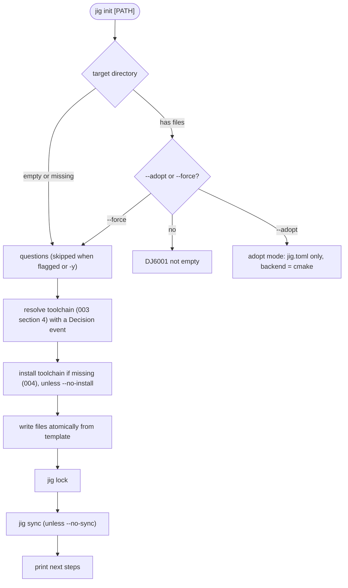

# 006 Init, wizard and templates

**Phase goal:** `jig init` creates a working project after the user has chosen language, standard, compiler vendor and compiler **version** (the version is chosen before anything is written), in a wizard or entirely through flags.
**Depends on:** 001 to 005. **Unlocks:** 007 and the first end-to-end demo.
**Libraries:** `jig-init`. Uses `jig-core`, `jig-index`, `jig-ui`.

---

## 1. The experience



The questions come in an order that makes the **standard** choose the **compiler**, because that is how people think ("I want C++23, what can build it?"). `--compiler-first` flips the order.

## 2. Questions and flags

| # | Question | Flag | Default with `-y` | Choices and rules |
|---|---|---|---|---|
| 1 | Project name | positional `PATH` or `--name` | directory name | Valid per `[project].name` rules. |
| 2 | Language | `--lang c\|c++` | `config.toml defaults.language`, else `c++` | |
| 3 | Standard | `--std <value>` | newest **stable** std the default compiler accepts | Only values valid for the language (003). |
| 4 | Compiler vendor | `--vendor llvm\|system` | `llvm` | `system` is H0. |
| 5 | Compiler version | `--toolchain <spec>` (for example `clang@20`) | highest version accepting `--std` | Shown **filtered** by the chosen std (section 3). |
| 6 | Project kind | `--kind exe\|static-lib\|shared-lib\|header-only` | `exe` | |
| 7 | Tests | `--tests none\|ctest` | `ctest` | v0.1 supports `ctest` only (plain executables registered with CTest). Frameworks come with dependencies in 009. |
| 8 | Formatter config | `--clang-format none\|llvm\|google\|mozilla\|webkit\|file` | `llvm` | Writes `.clang-format`. |
| 9 | Version control | `--vcs git\|none` | `git` when `git` is on `PATH` | Runs `git init`, writes `.gitignore`. Never commits. |
| 10 | License | `--license <SPDX>` | none | Writes the SPDX id in `jig.toml`; does not generate a LICENSE file in v0.1 (listed in the next-steps message). |

Other flags: `--no-install`, `--no-sync`, `--no-lock`, `--adopt`, `--force`, `--platforms <list>`, `--template <name>` (section 5), `--dry-run` (print the file list and the decisions, write nothing), `--no-interactive`, `-y`.

Non-TTY with a missing required value: exit 2, `DJ6003`, message names every missing flag at once.

## 3. Standard and compiler compatibility

The index (004) records which `-std=` values each compiler **measured** as accepted. `init` uses that, not a hand-written table. Example of what the user sees (illustrative data):

```
? Standard     › c++23
? Compiler     › clang (llvm, pinned)
? Version      ›
    20.1.8   latest 20.x            accepts c++14 c++17 c++20 c++23 c++26
  ▸ 19.1.7   latest 19.x            accepts c++14 c++17 c++20 c++23 c++26
    18.1.8   latest 18.x            accepts c++14 c++17 c++20 c++23 c++26
    17.0.6   latest 17.x            accepts c++14 c++17 c++20 c++23   (c++26 not accepted)
    16.0.6   hidden: does not accept c++23     [press a to show incompatible versions]
```

Rules:

- Incompatible versions are hidden by default and shown with `a`. Selecting one prints a warning and continues only with `--allow-incompatible`.
- "Accepts" means the flag is accepted, not that every feature of the standard is implemented. The wizard's help line says this. `jig doctor --features` (008) later reports library and language feature-test macros measured by the builder.
- Default selection is the highest **stable** version that accepts the std. Prereleases appear only with `--prerelease`.
- `c++26` is shown as "experimental" in the std list.
- The version list is built from the cached index. If no index is available and not offline, `init` fetches it (and says so). Offline with no cache: `DJ5001` with the `--vendor system` alternative.

## 4. Decisions printed during `init`

```
▸ Resolving toolchain
  ◆ language         c++
  ◆ standard         c++23              (you chose)
  ◆ compiler         llvm clang 20.1.8  (highest 20.x accepting c++23 for x86_64-unknown-linux-gnu)
  │ 7 versions in the index · 5 accept c++23 · 20.1.8 is the highest stable
  ◆ cmake / ninja    3.31.2 / 1.12.1    (from your [toolchain.tools] defaults)
  ◆ hermeticity      H1 pinned compiler
```

## 5. Templates

Templates live in `templates/` in the repository and are **embedded in the binary** (CMake generates a source file with the bytes, so no loose files are needed at run time).

| Template | Language | Kind | Contents |
|---|---|---|---|
| `cpp-exe` | C++ | exe | `src/main.cpp`, `tests/smoke.cpp` |
| `cpp-lib` | C++ | static-lib / shared-lib | `include/<name>/<name>.hpp`, `src/<name>.cpp`, `tests/smoke.cpp` |
| `cpp-header-only` | C++ | header-only | `include/<name>/<name>.hpp`, `tests/smoke.cpp` |
| `c-exe` | C | exe | `src/main.c`, `tests/smoke.c` |
| `c-lib` | C | static-lib / shared-lib | `include/<name>/<name>.h`, `src/<name>.c`, `tests/smoke.c` |
| `c-header-only` | C | header-only | `include/<name>/<name>.h`, `tests/smoke.c` |

Every template also writes: `jig.toml`, `.gitignore`, `.clang-format` (unless `none`), `README.md`.

Substitution: `{{name}}`, `{{name_upper}}`, `{{std}}`, `{{kind}}`, `{{toolchain_spec}}`, `{{version}}`. No loops, no conditionals; variants are separate template files. Unknown placeholders fail the build of jig (a test renders every template).

### 5.1 `cpp-exe` files (as generated)

`src/main.cpp`

```cpp
#include <print>

int main() {
    std::println("hello from {{name}}");
    return 0;
}
```

(`<print>` needs C++23. For `c++20` and below the template uses `<iostream>`; for `c++14` and `c++17` it uses `<iostream>` and no `std::println`. The renderer selects `cpp-exe` variants `main-23.cpp.tmpl` and `main-legacy.cpp.tmpl` by std.)

`tests/smoke.cpp`

```cpp
// A test is an executable. It returns 0 on success. jig registers each file in tests/ with CTest.
#include <cstdlib>

int main() {
    const bool ok = (1 + 1 == 2);
    return ok ? EXIT_SUCCESS : EXIT_FAILURE;
}
```

`jig.toml` (C++23, executable)

```toml
[project]
name     = "{{name}}"
version  = "0.1.0"
kind     = "exe"
language = "c++"
std      = "c++23"

[toolchain]
vendor  = "llvm"
version = "20"

[test]
sources = ["tests/**/*.cpp"]
```

`.gitignore`

```
.jig/
compile_commands.json
```

(`jig.lock` is committed.)

### 5.2 `cpp-lib` header

```cpp
#pragma once

namespace {{name}} {

/// Returns the library version string.
const char* version() noexcept;

}  // namespace {{name}}
```

### 5.3 `c-exe` main

```c
#include <stdio.h>

int main(void) {
    puts("hello from {{name}}");
    return 0;
}
```

## 6. Adopt mode (existing projects)

`jig init --adopt` in a directory that already has a `CMakeLists.txt`:

1. Does **not** modify or delete any existing file.
2. Asks (or takes flags) for language, std and toolchain spec; tries to guess from `CMAKE_CXX_STANDARD` in the top-level file and offers the guess as the default, labelled as a guess.
3. Writes `jig.toml` with `backend = "cmake"`.
4. Writes `.jig/` only on sync.
5. Prints the one command to build: `jig build`, which runs the project's own CMake with the jig toolchain file.

## 7. Example sessions

### 7.1 Fully non-interactive (CI or scripts)

```
$ jig init hello --lang c++ --std c++23 --toolchain clang@20 --kind exe --tests ctest -y

▸ Creating project           hello  (c++23 · exe)
▸ Resolving toolchain
  ◆ compiler         llvm clang 20.1.8
  ◆ hermeticity      H1 pinned compiler
▸ Installing toolchain       reused from the store
▸ Writing files
  + jig.toml   + .gitignore  + .clang-format  + README.md
  + src/main.cpp  + tests/smoke.cpp
▸ Locking                    jig.lock written (3 platforms)
▸ Syncing environment        .jig/env ready

  next:  cd hello  ·  jig run   ·  jig test
```

### 7.2 Dry run

```
$ jig init demo --lang c --std c17 --vendor system --dry-run -y

▸ Dry run. Nothing will be written.
  ◆ compiler         system cc  (gcc 14.2 detected at /usr/bin/cc)
  ◆ hermeticity      H0 detected (the machine decides the compiler)
  would write: jig.toml   .gitignore  .clang-format  README.md  src/main.c  tests/smoke.c
```

### 7.3 Incompatible choice

```
$ jig init old --lang c++ --std c++23 --toolchain clang@14 -y
✗ DJ2102  clang 14.x accepts up to c++20 for this platform

  help: pick a newer compiler:   --toolchain clang@17   (or newer)
        or a lower standard:     --std c++20
```

(Illustrative.)

## 8. Errors (this phase)

| Code | Condition |
|---|---|
| DJ6001 | Target directory is not empty (use `--adopt` or `--force`). |
| DJ6002 | Invalid project name. |
| DJ6003 | Non-interactive and required flags are missing (exit 2). |
| DJ6004 | Template rendering failed (a bug; includes the template name). |
| DJ6005 | `git` requested but not found (warning, not fatal). |
| DJ6006 | Adopt mode found no `CMakeLists.txt`. |

## 9. Agent tasks

1. Implement the wizard prompts on top of 002's framework, with the live explanation line and the `a` (show incompatible) key.
2. Implement the compatibility query over the index and its tests with fixtures where `languages` differ per version.
3. Implement the template embedder (CMake-time generation) and the renderer; add the test that renders every template for every std and kind and compiles the result with the fixture toolchain where available.
4. Implement `init` end to end including `--dry-run`, `--adopt` and the follow-up `lock` and `sync`.
5. Snapshot-test the transcripts in section 7 (golden files).

**Acceptance for 006:** `jig init demo -y` followed by `jig build` (007) produces a running program on the three tier-1 platforms; every template compiles at every std it claims; section 7 transcripts match golden files; `--dry-run` writes nothing (verified by a directory hash before and after).
