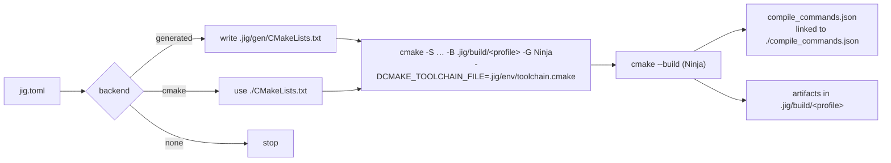

# 007 Build engine

**Phase goal:** turn `jig.toml` into a CMake project, configure and build it with Ninja inside the environment, and implement `build`, `run`, `test`, `fmt`, `clean`. Emit `compile_commands.json`. Make every step narrated.
**Depends on:** 001 to 006. **Unlocks:** 008 to 011.
**Libraries:** `jig-build`.

---

## 1. Backends

| `build.backend` | What jig does | Use when |
|---|---|---|
| `generated` (default) | Writes a CMake project to `.jig/gen/` from the manifest. The user never sees or edits it. | New projects. |
| `cmake` | Runs the project's own `CMakeLists.txt` with the jig toolchain file injected and the profile mapped to `CMAKE_BUILD_TYPE` and flags. | Adopted projects. |
| `none` | No build step. `jig exec` and `jig shell` still work. | Using jig only for the toolchain and environment. |



## 2. Generated CMake project

Generation is deterministic: same manifest and same lock produce the same bytes (so unchanged generation does not retrigger a reconfigure; jig writes the file only when the content differs).

Example for the manifest in 003 section 3:

```cmake
# Generated by jig 0.1.0. Do not edit. Source of truth: jig.toml
cmake_minimum_required(VERSION 3.25)
project(hello LANGUAGES CXX VERSION 0.1.0)

set(CMAKE_CXX_STANDARD 23)
set(CMAKE_CXX_STANDARD_REQUIRED ON)
set(CMAKE_CXX_EXTENSIONS OFF)
set(CMAKE_EXPORT_COMPILE_COMMANDS ON)

file(GLOB_RECURSE HELLO_SOURCES CONFIGURE_DEPENDS
     "${JIG_PROJECT_DIR}/src/*.cpp" "${JIG_PROJECT_DIR}/src/*.cc" "${JIG_PROJECT_DIR}/src/*.cxx")

add_executable(hello ${HELLO_SOURCES})
target_include_directories(hello PRIVATE "${JIG_PROJECT_DIR}/include" "${JIG_PROJECT_DIR}/src")
target_compile_definitions(hello PRIVATE HELLO_VERSION="0.1.0")
target_compile_options(hello PRIVATE -Wall -Wextra -Wpedantic)   # warnings = "strict"

# profile-driven flags are injected from the profile file below
include("${JIG_PROFILE_FILE}")

enable_testing()
file(GLOB_RECURSE HELLO_TESTS CONFIGURE_DEPENDS "${JIG_PROJECT_DIR}/tests/*.cpp")
foreach(t IN LISTS HELLO_TESTS)
  get_filename_component(tn "${t}" NAME_WE)
  add_executable(test_${tn} "${t}")
  target_link_libraries(test_${tn} PRIVATE hello_testlib)   # only when kind != exe, see section 3
  add_test(NAME ${tn} COMMAND test_${tn})
endforeach()
```

`JIG_PROJECT_DIR` and `JIG_PROFILE_FILE` are passed as `-D` arguments. Profile files (`.jig/gen/profile-<name>.cmake`) hold the flags from `[profile.<name>]`.

### 2.1 Kind mapping

| `kind` | CMake targets |
|---|---|
| `exe` | `add_executable(<name>)`. Tests link to a `<name>_core` object library built from all sources except the file that defines `main` (detected by the glob `src/main.*`). If no `src/main.*`, tests link to nothing extra. |
| `static-lib` | `add_library(<name> STATIC)` plus an `ALIAS` and `install` rules. |
| `shared-lib` | `add_library(<name> SHARED)`, `CMAKE_WINDOWS_EXPORT_ALL_SYMBOLS` is **off**; the template provides an export macro header. |
| `header-only` | `add_library(<name> INTERFACE)` with `target_include_directories(... INTERFACE ...)`. |

### 2.2 Profile mapping

| Manifest | GCC/Clang flag | MSVC / clang-cl flag |
|---|---|---|
| `opt = "0"` | `-O0` | `/Od` |
| `opt = "3"` | `-O3` | `/O2` |
| `opt = "s"` / `"z"` | `-Os` / `-Oz` | `/O1` |
| `debug = true` | `-g` | `/Zi` |
| `lto = "thin"` | `-flto=thin` | `/GL` with `/LTCG` |
| `lto = "full"` | `-flto` | `/GL` with `/LTCG` |
| `sanitizers = ["address"]` | `-fsanitize=address -fno-omit-frame-pointer` | `/fsanitize=address` |
| `sanitizers = ["undefined"]` | `-fsanitize=undefined` | not supported: `DJ4102` warning |
| `assertions = false` | `-DNDEBUG` | `/DNDEBUG` |
| `warnings = "strict"` | `-Wall -Wextra -Wpedantic` | `/W4` |

## 3. Commands

| Command | Behaviour |
|---|---|
| `jig build [--profile P] [--target T] [-j N] [--release]` | Sync if needed, generate, configure if needed, build. `--release` is `--profile release`. |
| `jig run [TARGET] [--profile P] -- ARGS` | Build, then run the executable. With one executable target, `TARGET` is optional. |
| `jig test [--profile P] [FILTER] [-- CTEST_ARGS]` | Build, then run `ctest` with `[test].args`. `FILTER` is passed as `-R`. Exit code 8 on failure. |
| `jig fmt [--check] [PATHS...]` | Run the pinned `clang-format` on sources and headers. `--check` exits 8 if any file would change. |
| `jig clean [--profile P] [--env] [--all]` | Remove build output. `--env` also removes `.jig/env`. `--all` removes `.jig/` except nothing else. |
| `jig check` (v0.2) | Reserved for `clang-tidy`. |

Common behaviour:

- **Incremental.** Reconfigure only when the manifest, lock, profile file or `CMakeLists.txt` changed (hash in `.jig/build/<profile>/.jig-config.json`).
- **Parallelism.** `-j` defaults to the logical CPU count. Printed as a decision.
- **Output passthrough.** Compiler and CMake output is streamed as `Output` events and shown dimmed at level 2 and normal at `-v`. Warnings and errors are never dimmed.
- **Failure.** A failed compile returns exit code 7 and prints the first failing command (always, even at `-q`) and the count of failing jobs.
- **compile_commands.json.** A symlink (junction or copy on Windows) at `./compile_commands.json` points to the active profile's file, so clangd works. `--no-compile-commands` skips it.
- **Windows.** The generator is Ninja with the compiler from the environment (so Visual Studio generators are never used).

## 4. Narrated build (reference transcript)

```
$ jig test

▸ Reading project          hello 0.1.0 · c++23 · exe · profile debug
▸ Environment              in sync (jig.lock a77c…19)
▸ Generating               .jig/gen/CMakeLists.txt unchanged
▸ Configuring              cache valid, skipped
▸ Building                 4 targets · -j 12 (12 logical CPUs)
  [4/4] Linking CXX executable test_smoke
  ✓ built in 1.4 s
▸ Testing                  ctest --output-on-failure
  1/1 Test #1: smoke ........................   Passed    0.00 sec
  ✓ 1 passed, 0 failed
```

(Illustrative.)

## 5. Use cases

| # | Scenario | Outcome |
|---|---|---|
| B1 | `jig init app && cd app && jig run` | Builds with the pinned compiler, prints the greeting. |
| B2 | Developer edits one `.cpp` and runs `jig build` | Only that file recompiles; configure is skipped. |
| B3 | `jig build --release` then `jig build` | Two independent build trees. |
| B4 | A profile has `sanitizers = ["address"]` | Flags appear in `compile_commands.json`; `jig test` fails on a leak. |
| B5 | `jig fmt --check` in CI | Exit 8 and a list of files when something differs. |
| B6 | Adopted CMake project | `jig build` runs the project's own CMake with the pinned compiler; sources untouched. |
| B7 | `[toolchain] version = "17"` and `std = "c++26"` | Fails early at lock time (`DJ2102`), before any build is attempted. |

## 6. Errors (this phase)

| Code | Condition |
|---|---|
| DJ4001 | CMake configure failed. Last 20 lines of CMake output are shown. |
| DJ4002 | Build failed. Shows the first failing command. |
| DJ4003 | No executable target to run. |
| DJ4004 | Multiple executable targets; name one. |
| DJ4005 | Test run failed (exit 8). |
| DJ4006 | `fmt --check` found differences (exit 8). |
| DJ4101 | Profile not found. |
| DJ4102 | Option not supported by this compiler (warning). |
| DJ4103 | Glob matched no source files (warning). |

## 7. Agent tasks

1. Implement the CMake generator as a pure function `Manifest + Lock + Profile -> files` and golden-test its output for every kind, language and profile.
2. Implement configure-skip logic and the `.jig-config.json` hash.
3. Implement build, run, test, fmt, clean on top of `platform::process`, streaming output as events.
4. Implement the compile-commands link.
5. Implement the `cmake` backend (toolchain file injection, `CMAKE_BUILD_TYPE` mapping, extra args).
6. Add the end-to-end suite B1 to B7 (the real compiler is used in a non-blocking CI job; a fake compiler script is used in the blocking job).

**Acceptance for 007:** on the three tier-1 platforms with a real pinned LLVM, `jig init demo -y && cd demo && jig test && jig build --release && jig fmt --check` succeed; generator golden tests are stable; configure is skipped on an unchanged second build.
