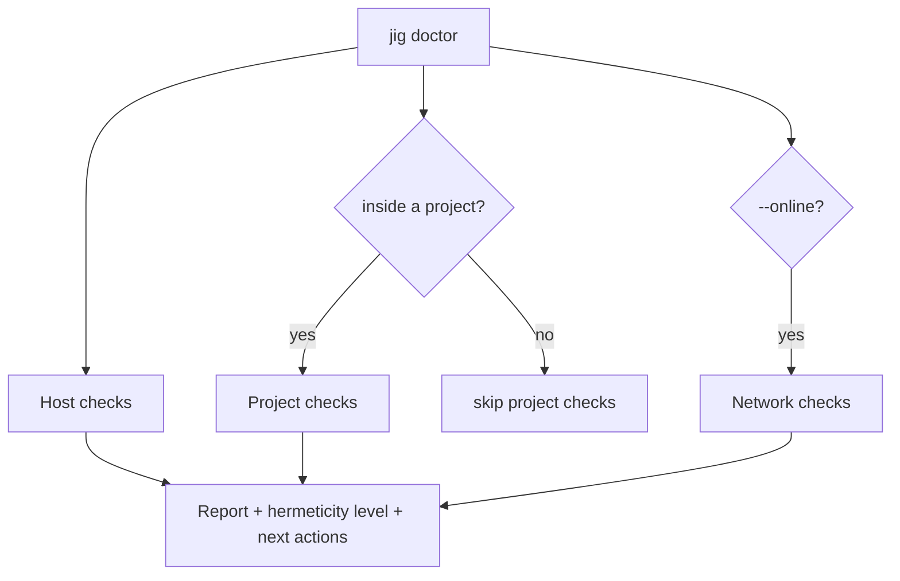

# 008 Doctor, explain and diagnostics

**Phase goal:** make jig tell the truth about itself. Implement `doctor`, the hermeticity classifier output, `--explain`, `--json` events end to end, and bug-report support.
**Depends on:** 001 to 007. **Unlocks:** 010.
**Libraries:** `jig-ui`, `jig-env`, `jig-core`.

---

## 1. `jig doctor`

Runs read-only checks and prints a report. It works inside and outside a project. It never changes anything and never touches the network unless `--online` is given.



### 1.1 Host checks

| Check | Pass | Fail or warn |
|---|---|---|
| Platform and architecture | tier 1 or 2 | `DJ8001` unsupported platform (warn) |
| `JIG_HOME` writable, free space ≥ 4 GiB | | `DJ8002` |
| Filesystem supports symlinks (or launcher fallback available) | | warn |
| Windows: Visual Studio Build Tools present when needed | | `DJ3201` |
| macOS: command line tools and SDK present | | `DJ3202` |
| Linux: glibc version recorded and compared with toolchains in store | | `DJ3203` |
| System compilers detected (list with versions) | informational | |
| Environment variables that leak (`CXXFLAGS`, ...) | none | list |
| Clock skew vs index `generated_at` > 10 min | | warn (signature windows) |

### 1.2 Project checks

| Check | Meaning |
|---|---|
| Manifest parses and validates | 003 |
| Lock fresh, covers `platforms` | 003 |
| Environment in sync | 005 |
| Locked toolchain installed and complete | 004 |
| Shims resolve to locked versions | 005 |
| Hermeticity vs required minimum | `[toolchain] hermeticity` |
| `std` accepted by the locked compiler | measured in the index |
| `compile_commands.json` present and recent | 007 |
| Build directory consistent with profile | 007 |

### 1.3 Network checks (`--online`)

Index reachable, signature valid, key chain valid, archive URLs for the locked entries respond to `HEAD` with the locked size. No downloads.

### 1.4 Example report

```
$ jig doctor

jig 0.1.0 · x86_64-unknown-linux-gnu · tier 1

Host
  ✓ JIG_HOME            ~/.local/share/jig    (212 GiB free)
  ✓ symlinks            supported
  ✓ glibc               2.39
  ! leaking variables   CXXFLAGS  (dropped inside the project environment)
  │ system compilers    gcc 14.2 (/usr/bin/gcc) · clang 18.1 (/usr/bin/clang)

Project  hello
  ✓ jig.toml            valid
  ✓ jig.lock            fresh, 3 platforms
  ✓ environment         in sync
  ✓ shims               clang 20.1.8 · cmake 3.31.2 · ninja 1.12.1
  ✓ std                 c++23 accepted by clang 20.1.8

Hermeticity            H1  pinned compiler            (required: h1)
  pinned               clang 20.1.8 · cmake 3.31.2 · ninja 1.12.1
  from the host        glibc · system headers · libstdc++
  to reach H2          needs jig 0.3 (pinned C++ runtime)

1 warning · 0 errors
```

(Illustrative.)

Exit codes: 0 no errors, 3 project problems, 4 toolchain problems, 1 other errors. Warnings do not change the exit code unless `--strict`.

### 1.5 Flags

| Flag | Effect |
|---|---|
| `--online` | Add network checks. |
| `--features` | Print language and library feature-test macro support measured by the index builder for the locked compiler and std (for example `__cpp_lib_expected`). |
| `--fix` | Apply only safe local fixes: re-run `sync`, recreate `compile_commands.json`, remove incomplete store directories. Prints each fix first. |
| `--strict` | Warnings fail. |
| `--json` | Machine-readable report. |

## 2. `--explain`

Any command accepts `--explain`. It prints, after the normal output, the **decision tree** for every `Decision` event: input, rule, outcome, alternatives.

```
$ jig lock --explain

  ◆ compiler  llvm clang 20.1.8
    ├─ spec          "20"                     from jig.toml [toolchain].version
    ├─ host          x86_64-unknown-linux-gnu detected
    ├─ candidates    12 llvm entries in the index
    │   ├─ dropped   9   version does not match "20"
    │   ├─ dropped   0   std c++23 not accepted
    │   ├─ dropped   0   hermeticity below h1
    │   └─ kept      3   20.1.6  20.1.7  20.1.8
    ├─ rule          highest stable
    └─ chosen        20.1.8        next best: 20.1.7
```

The tree is generated from the structured `Decision` fields (002 section 4.1), not from strings, so it cannot drift from behaviour.

## 3. JSON event stream

`--json` prints one object per line. Stable fields:

```json
{"event":"step","id":"resolve","title":"Resolving toolchain"}
{"event":"decision","id":"compiler","chosen":"llvm clang 20.1.8","why":["highest 20.x accepting c++23"],"alternatives":[{"name":"llvm clang 20.1.7","reason":"older patch"}]}
{"event":"download","url":"https://…","bytes_done":104857600,"bytes_total":912345678}
{"event":"verify","what":"archive","sha256":"9f3a…","ok":true}
{"event":"done","step":"resolve","ms":212,"summary":"clang 20.1.8"}
{"event":"fail","code":"DJ2101","summary":"No toolchain satisfies clang@25","help":"jig toolchain available --vendor llvm"}
```

The schema is published as `docs/reference/events.schema.json`. Event names and the fields above never change within a major version; new fields may be added.

## 4. Bug reports

`jig doctor --report` writes `jig-report-<timestamp>.txt` in the current directory containing: jig version and commit, platform, `jig doctor --json`, `jig.toml` (with `[env] set` values replaced by `<redacted>`), `jig.lock`, the last 200 lines of `JIG_HOME/log/jig.log`, and the list of leaking environment variable **names** (never values). It prints the path and asks the user to attach it manually. jig never uploads it.

Logging: `JIG_HOME/log/jig.log`, rotated at 5 MiB, 5 files, always at trace level (so a failure that was not run with `-vvv` can still be diagnosed). No secrets: URLs have query strings removed; environment values are never logged.

## 5. Panic and crash behaviour

- Top-level handler catches anything that escapes, prints `✗ DJ9000 Internal error` with the bug-report command, exits 101.
- On POSIX a `SIGSEGV`/`SIGABRT` handler prints a short message and, when available, a backtrace (`std::stacktrace` if the platform supports it), then exits 101.
- Ctrl-C is handled cooperatively: running children receive the interrupt, temporary files are removed, exit 130.

## 6. Use cases

| # | Scenario | Outcome |
|---|---|---|
| D1 | New user installs jig and runs `jig doctor` outside a project. | Host section only, plus "no project here" and a pointer to `jig init`. |
| D2 | CI step `jig doctor --strict --json`. | Fails on any warning; report is a CI artifact. |
| D3 | A teammate reports "works on my machine". | `jig doctor --report` from both machines; compare hermeticity and leaking variables. |
| D4 | Developer wonders why 20.1.8 was chosen. | `jig lock --explain`. |
| D5 | Interrupted install left a stray directory. | `jig doctor --fix` removes it after printing it. |

## 7. Errors (this phase)

| Code | Condition |
|---|---|
| DJ8001 | Unsupported platform (warning). |
| DJ8002 | `JIG_HOME` not writable or low on space. |
| DJ8003 | Doctor found problems under `--strict`. |
| DJ9000 | Internal error. |

## 8. Agent tasks

1. Implement the check framework (`Check { id, run() -> Finding }`) and the report renderers (human, JSON).
2. Implement each check in sections 1.1 to 1.3 with fixtures that force pass, warn and fail.
3. Implement `--explain` from `Decision` events and the JSON event schema; add a schema-validation test over a recorded run.
4. Implement `--report`, log rotation and redaction with a test that greps the report for a planted secret.
5. Implement the crash handlers and the interrupted-install recovery.

**Acceptance for 008:** every finding code is reproducible in a test; `doctor --json` validates against the schema; the report test finds no planted secret; killing jig mid-install and running `doctor --fix` returns the store to a clean state.
