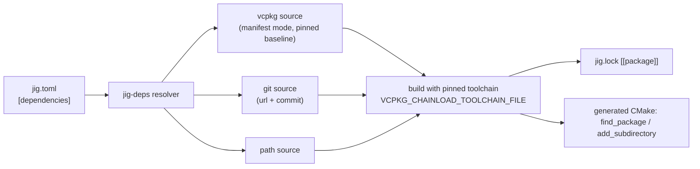

# 009 Dependencies (release v0.2)

**Phase goal:** add `jig add`, `jig remove` and a `[dependencies]` table, resolved through vcpkg, git and path sources, locked in `jig.lock`, built with the pinned compiler. Enable test frameworks in `init`. Make jig build itself with jig.
**Depends on:** 001 to 008. **Status:** designed now, implemented after v0.1 ships. The v0.1 parser rejects `[dependencies]` with `DJ1006`.
**Libraries:** `jig-deps` (new), changes in `jig-core`, `jig-build`, `jig-init`.

---

## 1. Principle

jig does not invent a package ecosystem. It **hands off** to systems that already have one, while making sure every hand-off uses the pinned compiler and records exact identities in the lock.



## 2. Manifest syntax

```toml
[dependencies]
fmt      = { vcpkg = "11" }                          # version spec, resolved against the pinned baseline
zlib     = { vcpkg = "*" }                           # whatever the baseline holds
tinylib  = { git = "https://github.com/example/tinylib", tag = "v1.4.0" }
mycore   = { path = "../mycore" }

[dev-dependencies]                                   # tests only
catch2   = { vcpkg = "3" }

[dependencies.fmt]                                   # long form
vcpkg    = "11"
features = ["unicode"]
```

| Key | Meaning |
|---|---|
| `vcpkg` | Package name is the table key. Value is a version spec (003 section 4). |
| `git` + `tag` / `rev` / `branch` | `rev` (full commit) is stored in the lock; `branch` is allowed but warned about (`DJ9101`). |
| `path` | Local project. Not allowed in published libraries (v0.2 does not publish). |
| `features` | Passed to vcpkg or to the dependency's CMake options when it is a jig project. |
| `link` | Override the CMake target name when it is not the default. |

## 3. Resolution and lock

- vcpkg is treated as a **tool**: the index gains `kind = "tool"`, `name = "vcpkg"` entries that pin a vcpkg release tree by sha256, so the baseline commit is part of the toolchain identity. `jig lock` writes `[[tool]] name = "vcpkg"` and `baseline = "<commit>"`.
- Resolved packages appear as:

```toml
[[package]]
name    = "fmt"
source  = "vcpkg"
version = "11.0.2"
baseline = "<vcpkg commit>"
features = ["unicode"]

[[package]]
name   = "tinylib"
source = "git"
url    = "https://github.com/example/tinylib"
rev    = "<full 40-hex commit>"
```

- `--locked` and `--frozen` behave as in 003. A dependency change makes the lock stale.
- A transitive dependency conflict is `DJ9102` with the full requirement chain, never a silent pick.

## 4. Building dependencies with the pinned compiler

| Concern | Rule |
|---|---|
| Compiler | vcpkg runs with `VCPKG_CHAINLOAD_TOOLCHAIN_FILE=.jig/env/toolchain.cmake`. |
| Triplet | Derived from host and profile (`x64-linux`, `arm64-osx`, `x64-windows-static` ...), written to `.jig/gen/triplets/` so it does not depend on the user's vcpkg files. |
| Host leakage | vcpkg is started with the same sanitised environment as `jig exec`. |
| Cache | Binary cache directory under `JIG_HOME/cache/deps`, keyed by vcpkg ABI hash, which already includes the compiler. |
| Offline | `--offline` uses the cache or fails with `DJ5001`. |

**Open question for the implementer:** vcpkg's own ABI hash covers the compiler it detects. Confirm in a test that a compiler change via the toolchain file changes the hash; if it does not, add the toolchain id to a custom triplet variable.

## 5. Commands

| Command | Behaviour |
|---|---|
| `jig add <name> [--vcpkg [VER] \| --git URL [--tag T\|--rev R] \| --path DIR] [--dev] [--features a,b]` | Edit `jig.toml` (comment-preserving), re-lock, sync. |
| `jig remove <name>` | Remove, re-lock. |
| `jig tree` | Print the resolved tree with sources and versions. |
| `jig lock --upgrade [<name>]` | Re-resolve to newer versions within specs. |
| `jig search <term>` | Query the vcpkg baseline's port list offline. |

## 6. Test frameworks in `init`

`--tests catch2|doctest|gtest|unity|ctest`. Choosing a framework adds a `[dev-dependencies]` entry and a template for the test file. `unity` is offered for C projects, the others for C++.

## 7. Self-hosting

From v0.2 the jig repository contains a `jig.toml` that builds jig itself with a pinned LLVM and the dependency list from 001 D-013 as vcpkg entries. CMake and `vcpkg.json` remain as the **bootstrap** path for people who do not have jig yet. CI builds both ways and compares the resulting binaries' `--version` output.

## 8. Use cases

| # | Scenario | Outcome |
|---|---|---|
| P1 | `jig add fmt` in a C++ project | `jig.toml` gains `fmt = { vcpkg = "<resolved>" }`, lock gains the package, `find_package(fmt)` is generated, `#include <fmt/core.h>` builds. |
| P2 | Two machines, same lock | Same package versions and baseline, same compiler hash. |
| P3 | Dependency needs a newer standard than the project | `DJ9103` explaining the mismatch and the two ways out. |
| P4 | `jig add --git ... --branch main` | Allowed, `DJ9101` warning that the lock will pin the commit. |
| P5 | Offline rebuild | Succeeds from the binary cache. |

## 9. Errors reserved

| Code | Condition |
|---|---|
| DJ9101 | Floating git branch (warning). |
| DJ9102 | Dependency conflict. |
| DJ9103 | Dependency requires a language standard the project does not use. |
| DJ9104 | vcpkg port build failed. |
| DJ9105 | Package not found in the baseline. |

## 10. Agent tasks (for the v0.2 milestone)

1. Add vcpkg tool entries to the index builder and a provider for them.
2. Implement the `[dependencies]` schema, the resolver, lock changes and the freshness rule.
3. Implement CMake generation of `find_package` / `add_subdirectory` blocks and triplet generation.
4. Implement `add`, `remove`, `tree`, `search` and the init test-framework choices.
5. Add the self-hosting `jig.toml` and the CI job that builds jig with jig.

**Acceptance for 009:** P1 to P5 pass on tier-1 platforms; the self-hosted build produces a working jig; the lock is byte-stable across two runs.
