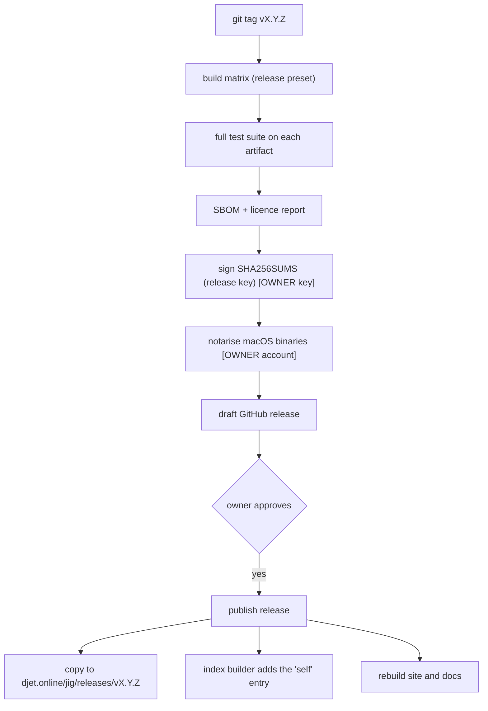

# 010 Distribution, release and the product page

**Phase goal:** produce signed release archives for every supported platform, installers, the self-update path, the docs site and the landing page under `https://djet.online/jig`.
**Depends on:** 001 to 008 (009 is not required for v0.1).
**Owner actions are marked [OWNER]:** things only the owner of DJET Systems can do (accounts, certificates, keys, DNS).

---

## 1. Release artifacts

| Artifact | Name | Contents |
|---|---|---|
| Linux x86_64, aarch64 | `jig-<version>-<triple>.tar.xz` | `jig`, `LICENSE`, `THIRD_PARTY_NOTICES.md`, `completions/` |
| macOS arm64, x86_64 | `jig-<version>-<triple>.tar.xz` | same, signed and notarised binary [OWNER] |
| Windows x86_64 | `jig-<version>-x86_64-pc-windows-msvc.zip` | `jig.exe`, `jig-shim.exe`, `LICENSE`, `THIRD_PARTY_NOTICES.md`, `completions/` |
| Checksums | `SHA256SUMS` | one line per artifact |
| Signature | `SHA256SUMS.sig` | ed25519 detached signature (release key) |
| SBOM | `jig-<version>.cdx.json` | CycloneDX 1.5 listing every linked library and version |
| Source | `jig-<version>-src.tar.gz` | tagged tree plus `vcpkg.json` with pinned baseline |

## 2. Static linking per platform (decision D-016)

| Platform | Release build | Why |
|---|---|---|
| Linux | Fully static, built in an Alpine (musl) container with GCC or Clang, `-static-pie`. A glibc dynamic build with static `libstdc++`/`libgcc` is the fallback if a musl issue is found (DNS resolution and locale are the usual suspects, test them). | No glibc floor for the CLI itself, one binary for every distribution. |
| macOS | System `libc++` and libSystem (Apple does not support fully static executables). Everything else static. | Platform rule. |
| Windows | `/MT` static CRT, all libraries static. | No redistributable needed. |

Test T-010-02 runs the produced Linux binary on a minimal container image with no libraries (`scratch` plus certificates) and asserts `jig --version` and `jig toolchain list` work.

## 3. Release pipeline

The pipeline stops at "draft". A person publishes. (Discipline.)

## 4. Installers and trust

| Command | Does |
|---|---|
| `curl -fsSL https://djet.online/jig/install.sh \| sh` | Detects platform, downloads archive and `SHA256SUMS` over TLS, verifies sha256, installs `jig` to `~/.local/bin` (or `--prefix`), prints the `PATH` line if needed. Never uses `sudo`. |
| `irm https://djet.online/jig/install.ps1 \| iex` | Same for Windows, installs to `%LOCALAPPDATA%\Programs\jig`, updates the user `PATH` only after asking. |
| Manual | Download archive and `SHA256SUMS` + `.sig`, verify the signature with any ed25519 tool and the public key published on the site and in `SECURITY.md`. |
| Packages (later) | Homebrew tap, winget, Scoop, AUR, apt/rpm repository. Each is a release-pipeline job added after v0.1. |

Trust statement published with the installers: the one-line installer trusts TLS to `djet.online` for the **first** install. After that, `jig self verify` checks the binary's own archive hash and signature against the embedded release key, and `jig self update` verifies every update (archive sha256 from the signed index, release signature) before replacing itself.

`install.sh` rules: POSIX `sh`, `set -eu`, no `eval` of downloaded text, prints every URL before fetching, supports `--dry-run`, `--version X`, `--prefix DIR`, `--no-modify-path`.

## 5. Self-update

`jig self update [--version X] [--check]`

1. Fetch the index (004). Find `kind = "self"` entries for this host.
2. Compare to the running version. `--check` prints and stops.
3. Download, verify sha256 (from the signed index) and release signature.
4. Replace the binary: write beside, `rename` over (POSIX); on Windows rename the running exe to `jig.old.exe`, move the new one in, delete the old at next start.
5. Keep the previous version in `JIG_HOME/self/previous/` for `jig self rollback`.

If jig was installed by a package manager (detected by install path), `self update` refuses and names the package manager (`DJ7001`).

## 6. Versioning and compatibility

| Surface | Rule |
|---|---|
| jig | SemVer. Before 1.0, minor versions may change behaviour; they are listed in the changelog under "Changed". |
| `jig.toml` | Unknown keys fail. New keys are added in minor releases. Removed keys go through one release of deprecation warnings. |
| `jig.lock` | `version` integer. A newer jig can read older locks. An older jig refuses newer ones (`DJ1104`). |
| Index | `format` integer and URL path (`v1`). Never mutated. |
| Events (`--json`) | Names and listed fields frozen within a major. |
| Error codes | Stable once released (D-008). |

## 7. The product page and docs site

| Surface | Source | URL |
|---|---|---|
| Landing page | `site/index.html` (single self-contained file) | `https://djet.online/jig` |
| Docs | `docs/user/*.md` rendered by a static site generator [OWNER chooses; MkDocs Material is the proposal since it renders Mermaid and offline search] | `https://djet.online/jig/docs` |
| Releases | GitHub Releases, mirrored | `https://djet.online/jig/releases/` |
| Index | static files | `https://djet.online/jig/index/v1/` |
| Installers | `site/install.sh`, `site/install.ps1` | `https://djet.online/jig/install.sh` |

Link from `https://djet.online`: add `jig` to the capabilities or a "Projects" row with a link to `/jig`, and a back link on the product page to `https://djet.online` (the page already has one). Restyling to the final DJET theme means editing the CSS custom properties at the top of `site/index.html`; no markup change is required.

Hosting needs only static files and correct MIME types (`.json`, `.sig`, `.sh`, `.ps1` served as plain downloads). The index host should send long `Cache-Control` on versioned release files and short on `index.json` (`max-age=300`) with an `ETag`.

## 8. Release checklist (v0.1.0)

1. [ ] All phase acceptance criteria 001 to 008 met on tier-1 platforms.
2. [ ] Include the AGPL-3.0-only license and all applicable third-party notices in source and binary releases.
3. [ ] Trademark and name search for "jig" completed (the word is common; check GitHub, package registries and trademark databases for developer tools using it, and document how jig is distinct). [OWNER]
4. [ ] Keys generated offline: root key, day-to-day index key, release key; public halves embedded; private halves stored per the key-custody note in `SECURITY.md`. [OWNER]
5. [ ] Apple Developer ID and notarisation set up; Windows code-signing decided (unsigned builds trigger SmartScreen). [OWNER]
6. [ ] Index builder has produced and signed a real index; `jig toolchain install clang@<x>` works against it on all tier-1 platforms.
7. [ ] `CHANGELOG.md` and `docs/RELEASE-0.1.0.md` filled in (hashes, dates, known issues).
8. [ ] Site deployed to a staging path and checked on desktop and phone; placeholders `{{...}}` and "preview" markers removed from `site/index.html`.
9. [ ] Installers tested on clean VMs: Ubuntu LTS, Fedora, Alpine, macOS arm64, Windows 11.
10. [ ] Tag, draft release, review, publish.

## 9. Errors (this phase)

| Code | Condition |
|---|---|
| DJ7001 | `self update` refused: installed by a package manager. |
| DJ7002 | No `self` entry for this host. |
| DJ7003 | Self-update signature or hash failure. |
| DJ7004 | Could not replace the running binary. |

## 10. Agent tasks

1. Write `release.yml` and `index.yml` workflows matching the diagram; build matrix with the `release` preset.
2. Write the Alpine static build image and T-010-02.
3. Write `install.sh` and `install.ps1` with shellcheck and PSScriptAnalyzer in CI, and tests on container images.
4. Implement `self update`, `self verify`, `self rollback`, `self where`.
5. Generate the SBOM and licence report in CI and fail on a licence outside the allow-list.
6. Wire the site build: copy `site/` and rendered docs into a deployable `dist/` folder; add a link checker.

**Acceptance for 010:** a dry-run release from a pre-release tag produces all artifacts, signatures verify with the public keys, installers work on the clean VMs in the checklist, and `self update` moves between two pre-release versions and rolls back.
