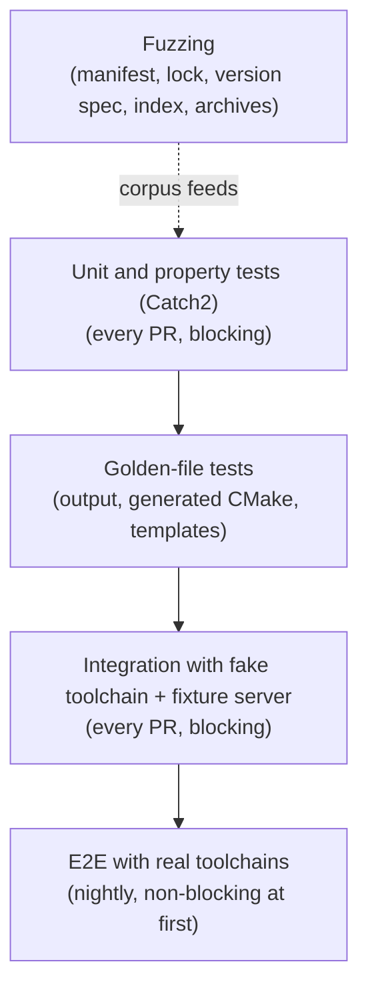

# 011 Testing strategy

**Phase goal:** make every promise in phases 001 to 010 executable. This file defines the test layers, the fixtures, the CI matrix and the named test IDs the other phases refer to.
**Applies to:** all phases. Tests are written **with** each phase, not after it.

---

## 1. Layers

| Layer | Tool | Runs | Purpose |
|---|---|---|---|
| Unit | Catch2 | every PR | Logic in `jig-core`, parsers, resolver, store pieces. |
| Property | Catch2 generators | every PR | Version-spec comparator, manifest round-trip, lock idempotence. |
| Golden | files under `tests/golden/`, update with `JIG_UPDATE_GOLDEN=1` | every PR | Human output, JSON events, generated CMake, rendered templates, error messages. |
| Integration | CTest scripts + fixture HTTP server | every PR | Commands against a **fake toolchain** (shell or batch scripts named `clang`, `clang++`, `cmake`, `ninja` with controlled output). |
| E2E | real LLVM, CMake, Ninja from a real signed index | nightly and pre-release | `init -> build -> test` on tier-1 platforms. |
| Fuzz | libFuzzer + sanitizers | scheduled | No crashes, hangs or sanitiser findings on hostile inputs. |
| Sanitizers | ASan, UBSan (all), TSan (store locks) | every PR on Linux | |

## 2. Fixtures

| Fixture | Description |
|---|---|
| `fake-toolchain/` | Scripts that mimic `--version`, `-dumpmachine`, `-std=... -fsyntax-only` and compile "successfully" by writing a tiny executable script. Versions selectable by environment. |
| `fixture-server` | Small HTTP server (a test-only target using the same libcurl-compatible protocol, built on a standard-library socket wrapper or cpp-httplib in tests only) serving `index.json`, `.sig`, archives, with switches: slow, drop connection at byte N, wrong hash, wrong signature, 500, redirect. |
| `keys/` | Test ed25519 key pairs (never used outside tests), including expired and unknown. |
| `archives/` | Valid tar.xz and zip, traversal, absolute path, symlink escape, bomb, truncated. |
| `projects/` | Sample manifests: minimal, full, invalid per error code. |
| `hosts/` | Fake `PATH` layouts per platform for system compiler detection. |

## 3. Named tests referenced by other phases

| ID | Phase | Asserts |
|---|---|---|
| T-002-01 | 002 | Every use case U1 to U7 behaves as specified. |
| T-002-02 | 002 | `reference/cli.md` matches the CLI11 tree. |
| T-003-01 | 003 | Manifest in 003 section 3 round-trips. |
| T-003-02 | 003 | `jig lock` twice changes no bytes. |
| T-003-03 | 003 | Every `DJ1xxx` is reproducible. |
| T-004-01 | 004 | Tampered index is rejected (`DJ5101`) with no fallback. |
| T-004-02 | 004 | Install is resumable and verifies size and hash. |
| T-004-03 | 004 | Kill at random byte offsets never leaves a complete-marked broken install. |
| T-004-04 | 004 | Malicious archives are rejected (`DJ5105`). |
| T-004-05 | 004 | `--offline` installs from cache without a socket (verified by sandbox). |
| T-005-01 | 005 | `sync` twice changes no bytes. |
| T-005-02 | 005 | Environment drops the listed host variables. |
| T-005-03 | 005 | Compiler works through each shim kind (real LLVM, E2E). |
| T-005-06 | 005 | Killed `sync` leaves the previous environment intact. |
| T-006-01 | 006 | Every template renders and compiles at every std it claims. |
| T-006-02 | 006 | `--dry-run` writes nothing (directory hash). |
| T-007-01 | 007 | Generated CMake is stable (golden). |
| T-007-02 | 007 | Unchanged second build skips configure. |
| T-008-01 | 008 | `doctor --json` validates against the schema. |
| T-008-02 | 008 | `--report` contains no planted secret. |
| T-010-02 | 010 | Static Linux binary runs on an empty image. |

## 4. Fuzz targets

| Target | Input | Property |
|---|---|---|
| `fuzz_version_spec` | arbitrary bytes | never crashes; parse then print then parse is stable. |
| `fuzz_manifest` | arbitrary TOML-ish bytes | returns a `JigError` or a valid manifest; never throws out of the library. |
| `fuzz_lock` | arbitrary bytes | same. |
| `fuzz_index` | arbitrary JSON | same; memory bounded. |
| `fuzz_extract` | arbitrary archive bytes | never writes outside the sandbox directory (verified by a canary), bounded resources. |
| `fuzz_ui_events` | arbitrary event sequences | renderers never crash and the JSON renderer always emits valid JSON. |

Seeds come from the fixtures. Any crash found becomes a regression test before the fix.

## 5. CI matrix

| Job | OS | Compiler | Preset | Blocking |
|---|---|---|---|---|
| build-test | ubuntu-latest | GCC 14 | `ci` | yes |
| build-test | ubuntu-latest | Clang 18+ | `ci` | yes |
| build-test | macos (arm64) | Apple Clang / LLVM | `ci` | yes |
| build-test | windows-latest | MSVC 19.40+ | `ci` | yes |
| sanitizers | ubuntu-latest | Clang | `dev` (ASan, UBSan) | yes |
| tsan | ubuntu-latest | Clang | `tsan` | yes |
| e2e-real | ubuntu, macos, windows | pinned LLVM via jig | `ci` | no, until stable for two weeks |
| fuzz | ubuntu-latest | Clang | `fuzz` | scheduled |
| lint | ubuntu-latest | clang-format, clang-tidy, shellcheck, PSScriptAnalyzer | | yes |
| docs | ubuntu-latest | link check, Mermaid render check | | yes |

(Exact runner images and compiler versions are confirmed by the 001 CI task; the minimums are in decision D-014.)

## 6. Quality rules

- A bug fix lands with a test that fails without it.
- New user-visible text lands with a golden update that a reviewer reads.
- Flaky tests are quarantined within one day and fixed within one week; a quarantined test has an owner and an issue.
- Timing assertions are avoided. Where a performance budget is wanted, it is a **benchmark job** that records numbers over time (`reference/performance.md` is created only when real measurements exist; no number appears in public text without a script in the repository that reproduces it).

## 7. Agent tasks

1. Create the fixture tree and the fixture server first (they unblock 004 to 008).
2. Add the golden-file helper with `JIG_UPDATE_GOLDEN`.
3. Add the CI jobs in section 5 as each phase lands them; do not wait until the end.
4. Add fuzz targets with the phase that creates the parser they exercise.

**Acceptance for 011:** every ID in section 3 exists, runs in CI, and fails when the behaviour it guards is broken (the agent verifies this by mutating the code once for each ID).
