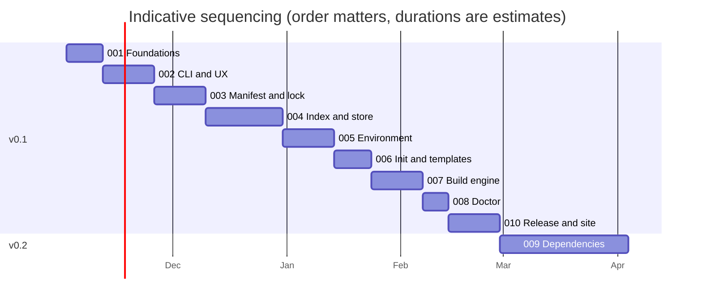
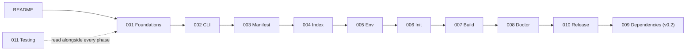

# 012 Roadmap, risks and open decisions

**Phase goal:** give the owner and the coding agent one place to see sequencing, what ships when, what can go wrong, and what only the owner can decide.

---

## 1. Milestones

| Release | Theme | Contents | Phases |
|---|---|---|---|
| **v0.1** | Pin and build | `init`, toolchains (`llvm`, `system`), CMake and Ninja tools, environment, build/run/test/fmt, doctor, signed index, installers, site | 001 to 008, 010, 011 |
| **v0.2** | Dependencies and self-hosting | `add`/`remove`/`tree`, vcpkg, git and path deps, test frameworks in `init`, jig builds itself | 009 |
| **v0.3** | Hermetic | Zig `cc` provider, pinned C++ runtime and sysroots (H2, H3), cross-compilation targets, reproducible-build verification | new phase 013 |
| **v0.4** | More compilers | GCC provider from audited third-party builds, clang-tidy integration (`jig check`), package-manager distribution | new phase 014 |
| **1.0** | Stability promise | Manifest, lock, events and error codes frozen; documented upgrade policy | |

Durations assume one experienced developer working with a coding agent. They are for sequencing and are not a commitment.

## 2. Definition of done for v0.1

1. Phase acceptance criteria 001 to 008 and 010 pass on Linux x86_64, macOS arm64, Windows x86_64.
2. Real signed index in production; `jig init demo -y && cd demo && jig test` works on a clean machine with no compiler installed (Linux and macOS; Windows requires Visual Studio Build Tools, documented).
3. Release artifacts signed, installers verified on clean VMs.
4. Docs site and landing page published; every command in the docs is covered by a test that runs it.
5. No known data-loss bug, no known security bug, no unreviewed `DJ9000`.

## 3. Risk register

| ID | Risk | Likelihood | Impact | Mitigation |
|---|---|---|---|---|
| R1 | Upstream release layout changes break the index builder. | Medium | Medium | Builder is the only component that knows layouts; client is insulated. Nightly builder job; PR instead of auto-publish on large diffs. |
| R2 | A pinned LLVM binary does not run on an old host (glibc floor, missing libs). | Medium | High | `requires_host` in the index, `DJ3203` with a clear message, E2E on old and new images. |
| R3 | Compilers on Windows and macOS need platform SDKs jig cannot bundle. | Certain | Medium | Detect and explain (D-009); document the exact install step; consider SDK packaging only after a licence review. |
| R4 | Name clash or confusion with other projects called "jig" (the word is common). | Medium | Medium | Name search and trademark check before release (owner); the first line of the README says what jig is and is not. |
| R5 | Signing key compromise. | Low | Critical | Offline root key, short-lived day-to-day key, revocation list, documented rotation; keys never in CI logs; two-person rule for root. |
| R6 | Scope grows into a build system. | High | High | D-002. A feature that needs its own build language is out of scope. Review every proposal against "does this need a new build graph". |
| R7 | The "isolation" promise is read as stronger than it is. | Medium | High | Hermeticity levels, `doctor` honesty, landing page copy states H1 plainly. |
| R8 | Static musl build misbehaves (DNS, locale, TLS roots). | Medium | Medium | T-010-02, glibc fallback, certificate bundle strategy decided in 010. |
| R9 | Maintainer time. | High | High | Narrow v0.1; phases are independently shippable; coding agent handles breadth, human reviews design and security. |
| R10 | A competitor ships the same idea first (build2, caxe and others already cover parts). | Medium | Low | Differentiate on pinned toolchains by hash, a signed index, an explicit hermeticity model and narrated output. Be accurate about what others do in `docs/user/comparison.md`. |

## 4. Open decisions for the owner

License decision D-006 is closed: project-authored material uses AGPL-3.0-only.
Vendored dependencies remain under their respective licenses.

| # | Decision | Needed by | Default if no answer |
|---|---|---|---|
| O-2 | GitHub organisation slug and repository visibility during development. | before 001 | `ansgrb/jig`, public for community development |
| O-3 | Where `djet.online` is hosted and how `/jig` is deployed (static copy, CI deploy, subdomain `jig.djet.online`). | before 010 | static path `/jig` |
| O-4 | Key custody: who holds the root key, where, and how rotation is performed. | before the first signed index | hardware key, offline, documented |
| O-5 | Apple Developer account and Windows signing certificate. | before v0.1 | ship unsigned Windows build with a SmartScreen note; macOS notarisation required |
| O-6 | Trademark and name search for "jig". | before announcement | |
| O-7 | Documentation generator for `docs/user/` and the final DJET documentation style (to be supplied). | before docs site | MkDocs Material, restyled later |
| O-8 | Final DJET theme tokens for the landing page (to be supplied). | before announcement | monochrome theme derived from the logo files already supplied |
| O-9 | Whether to offer a `djet.online/jig/index` mirror under a second domain for resilience. | before v0.2 | no |
| O-10 | Telemetry: confirm "none" for v0.1 (D-010). | before 010 | none |

## 5. How a coding agent should use this blueprint

1. Read `001` completely. Then read only the phase you are implementing and the phases it depends on.
2. Work in the order of the phase's **Agent tasks**. Keep the phase's **Acceptance** section open; do not call a phase done until each item passes.
3. When something is ambiguous, check `docs/reference/` first (the sheets are the contract), then the decision log in 001. If still ambiguous, write the question and your default into a `docs/blueprint/QUESTIONS.md` and continue with the default.
4. Never change a decision silently. Add a row to the decision log in 001.
5. After each phase, update `CHANGELOG.md` and `docs/user/` pages for every user-visible behaviour, with an example that a test runs.

## 6. Reading order

