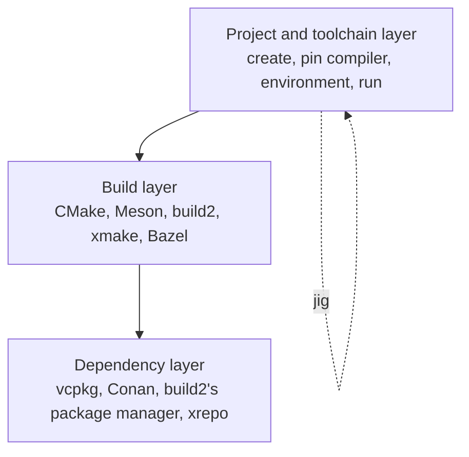

# Comparison

jig sits in a space that already has good tools. This page says what each does as described by its own project at the time of writing, and where jig is different. Check each project's documentation for current details.

## The layers

jig works in the top layer and uses CMake with Ninja for the build layer. From v0.2 it hands dependencies to vcpkg.

## Other tools

| Tool | What its project describes | Difference with jig |
|---|---|---|
| **build2** | An integrated C/C++ build toolchain: its own build system, package manager and project manager, aiming to approximate Cargo's convenience with a uniform interface across platforms and compilers. | build2 replaces the build layer with its own. jig keeps CMake and Ninja, so existing projects and IDE support carry over. |
| **caxe (`cx`)** | A project manager for C and C++ that scaffolds, builds, tests and formats, detects compilers, and can install portable toolchains. | jig pins the compiler by hash from a signed index, records it in a lock, and reports a hermeticity level. |
| **CMake** | A build-system generator. | jig generates CMake for you and runs it inside the environment. |
| **Conan, vcpkg** | Package managers for C and C++ libraries. | Different layer. jig v0.2 uses vcpkg. |
| **xmake, Meson, Bazel** | Build systems with their own languages and models. | Different build layer. |
| **Nix, conda** | General-purpose environments and package systems. | Much wider scope. jig is only about the native C/C++ workflow and ships one static binary. |
| **`uv`, `cargo`** | The inspiration: project, lock, environment and toolchain in one tool for Python and Rust. | jig brings that shape to native C and C++. |

## A note on names

"jig" is a common word and other, unrelated projects use it. This one is a C and C++ toolchain and project manager made by DJET Systems. Its binary, repository and documentation are all named jig, and it lives at https://djet.online/jig.

## When jig is not the right tool

- You already build with Bazel, Meson or build2 and are happy. Keep going.
- You must target a platform no provider supports.
- You need H2 or H3 isolation today. Wait for 0.3.
- You are fine with whatever compiler is on the machine and do not need to share an exact version. Plain CMake is simpler.
