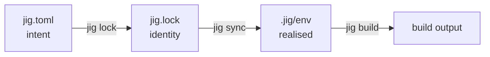

# Concepts

Six ideas explain all of jig.

## 1. Intent and identity

`jig.toml` says what you **intend**: "C++23, clang 20, strict warnings". `jig.lock` records what you **got**: "clang 20.1.8, this archive, this sha256, for these platforms". You edit the first. jig writes the second. You commit both.



## 2. The index

Compilers come from a **signed index** that DJET Systems publishes. For every compiler version it lists the download, its size and hash, which `-std=` values the compiler really accepted when it was tested, and which tools it provides. jig checks the index signature, then checks every download against the hash in the index. If either check fails, jig stops. There is no switch to skip them.

## 3. The store

Compilers are installed once into a shared, content-addressed **store** in your user directory. Ten projects that use clang 20.1.8 share one copy. Installs are atomic: a crash can leave nothing half-installed.

## 4. The environment

Each project has an **environment** in `.jig/env`: small shims that point into the store, a CMake toolchain file, and activation scripts for bash, zsh, fish, PowerShell and cmd. Inside it, `cc` and `c++` are the pinned compiler. Variables like `CXXFLAGS` or `LD_LIBRARY_PATH` that would leak the machine into the build are removed by default.

## 5. Profiles and targets

A **profile** is a named set of compile options (`debug`, `release`, or your own). A **target** is something to build: an executable or a library. A simple project has one target named after the project.

## 6. Hermeticity

jig does not claim more isolation than it has. It reports a **hermeticity level**:

| Level | Meaning |
|---|---|
| H0 | The machine's compiler was detected. Nothing is pinned. |
| H1 | Compiler, CMake and Ninja are pinned by hash. The C library, system headers and platform SDK still come from the machine. |
| H2 | Also the compiler's own C++ runtime and a sysroot. *(v0.3)* |
| H3 | Build for any target from any host. *(v0.3)* |

`jig doctor` prints your level and what would raise it. See [Hermeticity](hermeticity.md).

## The narration principle

jig prints what it decides and why. Reading a normal run teaches you how it works. When something goes wrong the error says what is true, then gives a command to try, then links to the error code.

```
✗ DJ2102  clang 14.x accepts up to c++20 for this platform

  help: pick a newer compiler:   --toolchain clang@17   (or newer)
        or a lower standard:     --std c++20
  docs: https://djet.online/jig/docs/errors#DJ2102
```
